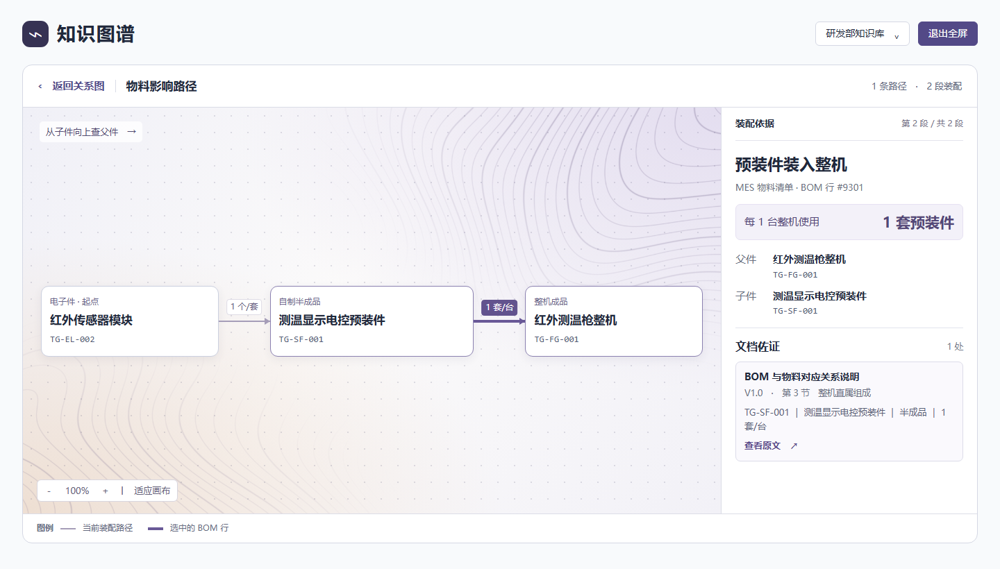

# 物料影响路径 · GraphRAG 产品需求与实施说明

**交付范围**　电脑端 MES 知识图谱、GraphRAG 问答和只读后端。本文是待实现的设计，配图是交互效果示意。

## 1. 用户点开第二条线，应该看到什么

在知识图谱选中「红外传感器模块」，点 **查看影响路径**。从左到右出现三张卡片：红外传感器模块 → 测温显示电控预装件 → 红外测温枪整机。第一段箭头写「1 个/套」，第二段写「1 套/台」。这里的“影响”指某个零件被哪些上级产品使用。判断某批货是否受影响，还需要批次和工单数据，属于另一项业务。

当老师点第二段的 **1 套/台**，右栏立即展开 **MES 物料清单 · BOM 行 #9301**。父件是整机，子件是预装件，每生产 1 台整机需要 1 套预装件。下方如有当前账号可读、能证明这段装配关系的资料，再显示「查看原文」。老师可以对照行号、编码和单位，自己判断这条连线是否成立。



*图中的文档卡片假设当前账号可读研发部库，且该说明书的相应版本已启用。产品运行时使用当时的记录、标题、版本及原文。*

### 可以直接核对的两行数据

| 点击哪一段 | 子件 → 父件 | 单个父件用量 | 初始化数据的 BOM 行 |
| --- | --- | --- | --- |
| 第一段 · 直接使用 | `TG-EL-002` 红外传感器模块 → `TG-SF-001` 测温显示电控预装件 | 1 个传感器 / 1 套预装件 | `9312` |
| 第二段 · 继续向上 | `TG-SF-001` 测温显示电控预装件 → `TG-FG-001` 红外测温枪整机 | 1 套预装件 / 1 台整机 | `9301` |

因此，对传感器而言，预装件是**直接上级**，整机是**经预装件到达的间接上级**。画布只画上表两条直接装配边。如果数据库里新增了一条传感器直接装入另一产品的 BOM 记录，它应自然成为另一条可选路径。编码、行号和用量均从当前库查询。数据出处见[演示初始化 SQL](../../sql/thermometer_init.sql)。

## 2. 为什么现有功能需要补这一层

| 现有能力 | 本次怎么用 |
| --- | --- |
| 文档图谱把 MES 的 `PRODUCT` 映射为 `Product`。现有 `relate` 支持 Item 用于 Product，预装件与整机却都是 Product。 | 由 BOM 行确定一段直接装配。两端可以都是 Product，也可以只有 BOM 来源。普通文档抽取继续服务其他实体关系。 |
| 「BOM 展开」按父件向下找组件，最终按组件汇总累计用量。 | 新增反向查询，按子件找父件，并为每一段保留原始行号和直接用量。原工具继续回答“生产一台需要哪些料”。 |
| 现有图谱侧栏呈现实体资料，普通图谱会过滤没有可见文档片段的边。 | 单独返回影响路径结果。BOM 行负责证明装配，文档附在具体的一段上。现有画布、缩放、全屏与原文预览继续复用。 |

代码出处：[图谱实体映射](../../backend/ktg-mes/ktg-mes/src/main/resources/mapper/ai/KbGraphMapper.xml) · [文档关系规则](../../backend/ktg-mes/ktg-mes/src/main/java/com/ktg/mes/ai/service/KbGraphExtraction.java) · [现有 BOM 查询](../../backend/ktg-mes/ktg-mes/src/main/resources/mapper/ai/AiReadToolMapper.xml) · [现有图谱装配逻辑](../../backend/ktg-mes/ktg-mes/src/main/java/com/ktg/mes/ai/service/KbGraphService.java)

## 3. 电脑端交互

| 用户动作 | 画布与右栏的响应 |
| --- | --- |
| 选中有 MES 编码的物料或产品 | 在右栏「展开邻居」下方放「查看影响路径」。如果普通图谱为空或服务离线，用户仍可在现有搜索框输入完整 MES 编码，使用「按此编码查影响路径」。两种入口共用权限与接口。 |
| 进入影响路径 | 保留部门库、全屏状态和等温线背景。用路径工具栏替换普通图谱筛选，固定从左向右排「起点 → 直接父件 → 更高层父件」。只显示所选路径，右栏先列各段的父子件与用量。 |
| 出现多个装配去向 | 在工具栏提供路径选择，选项展示途经编码和终点，以区别“同一整机、不同途经件”。单一路径省去选择器。切换路径后清除上一条的选边与依据。 |
| 点击箭头、用量标签或右侧某一段 | 该段箭头加粗、标签反白，两端卡片描边；其余路径段保持可读。右栏显示段序、父件和子件的名称编码、每个父件用量和 BOM 行号。右栏列表支持键盘选段。 |
| 点击「查看原文」 | 打开现有原文抽屉，定位真实版本和片段，突出匹配的原文行。有多段上下文时可分别打开。保留画布位置，关闭抽屉仍选中原来的边。 |
| 返回关系图或切换部门库 | 返回时恢复原先的搜索、筛选、节点、缩放与位置。切库则清除旧路径、选边和文档；迟到的旧响应不能覆盖新库或新选边。 |

**画面取舍。** 沿用当前卡片、淡紫与暖砂色等温线。把行号、完整名称和引文留给右栏，画布只承载方向和用量。在 1366×768 的桌面及项目已有全屏模式下，三张演示卡片和两个用量标签应能同时看清。桌面结构参考了 Twenty 的工作流详情页：中间保留当前选择，右侧就地展开明细。[Twenty 桌面参考 · Mobbin](https://mobbin.com/screens/e070fb11-603c-45cc-a3af-72231b4a024f?utm_source=chatgpt&utm_medium=ai-assistant&utm_source_platform=mcp)

**前端接入。** 在 [KnowledgeGraph.vue](../../ktg-mes-ui/src/views/mes/ai/KnowledgeGraph.vue) 管理浏览/影响路径两种状态、请求序号和来源抽屉。在 [KnowledgeGraphCanvas.vue](../../ktg-mes-ui/src/views/mes/ai/KnowledgeGraphCanvas.vue) 增加可选的选边事件、独立的透明描边点击区域及选边样式；当前 SVG 层关闭了指针事件，命中线时要阻止画布拖拽。用量标签也可直接选中边。普通图谱继续使用原布局，影响路径按返回的边序排列。新增两个请求函数放到 [knowledgeLibrary.js](../../ktg-mes-ui/src/api/mes/knowledgeLibrary.js)。

## 4. 后端怎样查出一条可信的路径

采用**查询时组合**。MySQL 中的物料清单提供装配事实，当前可读知识库提供佐证；两者以父子件身份和明确的装配方向对应。V1 可在原有 Spring Boot + MyBatis 模块完成，无需新建关系表、往 Neo4j 同步全量 BOM 或重建向量索引。

1. **定位起点。** 用完整编码精确查询 `md_item`，取稳定的 `item_id`。节点沿用 `Item:编码` / `Product:编码`，类型按主数据映射。卡片副标题取 `item_type_name`。演示库用 `item_type_code=TG_FG` 标识整机成品、`TG_SF` 标识自制半成品；普通 Product 不能一律标成整机。把成品分类判断集中在服务一处。
2. **反向走每一跳。** 新增批量查询，以当前层的一组 ID 匹配 `md_product_bom.bom_item_id`（子件），取 `item_id`（父件），仅保留 `enable_flag='Y'` 的关系。联查两端 `md_item` 得名称、编码和单位。边 ID 为 `bom:实际bom_id`。子件用量取 BOM 行的 `quantity`、`unit_name`（缺失回退 `unit_of_measure`），分母取父件的主数据单位。后端使用十进制数，前端展示时去掉末尾零。
3. **组装有序路径。** 服务层逐层扩展，保留每条路径已经经过的物料 ID。遇到回环只停止对应分支；不同分支汇入同一整机仍保留各自路径。按父件编码、行号稳定遍历，响应中优先列已到达整机的路径，再按长度、编码及行号排序。单条路径遇到整机、无上级或深度上限时停止。无上级的普通物料显示「当前追溯到此」，不能自动叫整机。
4. **控制规模。** V1 建议上限为 6 层、20 条返回路径、200 次候选装配段扩展。达到容量上限，多取一条或探查下一层确认是否还有结果；明确返回 `limited` 和停止原因。对循环只呈现已经确认的非循环段。起点无任何有效上级时返回成功、零条路径。查询使用绑定参数，并限制每批 SQL 读取量。
5. **保留旧行为。** 建议新增 `BomImpactService`，由页面和问答调用；在现有 `AiReadToolMapper.java/.xml` 增加独立查询方法。原 `bom` 方法的向下查询、汇总口径和返回字段继续供原调用方使用。图谱浏览控制器的 Neo4j 在线检查只适用于原浏览接口。

### 文档怎么证明“这一段”

| 一段关系 | 可以附到该边的原文 | 实现判定 |
| --- | --- | --- |
| 传感器 → 电控预装件 | 演示说明书 §4.1 的标题点名 `TG-SF-001`，下属表格列出 `TG-EL-002`、红外传感器模块和「1 个/套」。 | 标题明确父件，当前表内的目标行明确子件。也可接受原文明说该子件装入该父件的肯定句。 |
| 电控预装件 → 整机 | §2 明确整机编码 `TG-FG-001`，§3「整机直属组成」表中的 `TG-SF-001` 行写明「1 套/台」。 | §3 的行没有写父件编码，需在同一有效版本核对该表所属的整机上下文。原文入口以 §3 的行为主，并可展开 §2 上下文。 |

原文见[《BOM 与物料对应关系说明》V1.0](../demo-kb/04_BOM与物料对应关系说明_V1.0.md)。没有「直接组成」语义的共同提及、工序流转或“最终装配于”只能作为检索线索；它们不能把传感器直接连到整机。

**可实施的最小匹配规则。** 在授权库内查找含物料编码的片段作为候选，再读取同版本的必要相邻片段。V1 支持两类强依据：① 明确父子方向的装配肯定句，排除否定、替代和间接表述；② 有唯一父件上下文的直属 BOM 表格行。Markdown 按标题层级和表边界归属行。对于「整机直属组成」这类无编码标题，仅在同文档范围或整体结构明确唯一整机时绑定；跨到下一个同级标题就结束表归属。不能唯一确认则省略该引用。不要把整段文档挂到所有边上。

现有 Markdown 解析器按长度和行分块，`sectionLabel` 可能只是“第 N 行起”。保留实际的 `versionId / chunkIndex / sectionLabel`；只有匹配到原文标题才另给 `clauseLabel`。表行和父件上下文跨片段时，把各自的位置随引用返回。摘录取匹配行或原句。旧资料无需重新上传。文档与 BOM 数字有差异时，关系明确仍可引用，侧栏并列显示原文与**当前 BOM 用量**，提示两者数值有差异。

### 权限与失败处理

| 情况 | 服务端和界面行为 |
| --- | --- |
| 读取影响路径或某一行 | 所有入口使用同一个服务端权限判断：AI 查询 `mes:ai:query`、BOM 工具使用的物料列表权限 `mes:md:mditem:list`、BOM 行详情权限 `mes:md:mditem:query`，并调用 `KbDocumentService.readScope(libraryId)`。图谱端隐藏无权入口；手工请求被拒。问答不得绕过此判断。 |
| 检索证据 | 按服务端确定的 `deptId + libraryId` 查询，仅使用未删除文档、当前生效版本，并尊重文档的「纳入知识图谱」设置。沿用 `KbRetrievalMapper.activeHits` 的复核思路，再核对 `graph_enabled`。标题、摘要、定位和条数都从授权后的结果生成。BOM 是 MES 主数据，部门库决定此次可附的文档范围。 |
| 有 BOM，未命中可见条款 | 仍返回完整的已确认路径及 BOM 行。右栏显示「当前知识库暂无可引用条款」。不透露其他库是否存在文件。文档服务出错时另显示「文档依据暂不可读取」，保留已加载 BOM。 |
| 数据变化或服务异常 | 点击某段时重新读取启用的 BOM 行并核对路径。记录删除、停用、父子件变更时提示「装配关系已变化，请刷新路径」。同一行用量改变时同步更新画布和右栏。原文预览复用既有接口，增加仅对本功能生效的“当前图谱证据”参数，在返回正文前校验库、启用状态与当前版本；原有历史版本预览仍可使用。MySQL 查询失败显示「影响路径暂不可读取」和重试。 |

权限依据见[现有只读 BOM 工具](../../backend/ktg-mes/ktg-mes/src/main/java/com/ktg/mes/ai/service/AiReadTools.java)、[BOM 行详情控制器](../../backend/ktg-mes/ktg-mes/src/main/java/com/ktg/mes/md/controller/MdProductBomController.java)及[部门文档权限](../../backend/ktg-mes/ktg-mes/src/main/java/com/ktg/mes/ai/service/KbDocumentService.java)。

## 5. 前后端接口约定

两个新增只读接口共用前缀 `/mes/ai/kb/libraries/{libraryId}/graph`，按项目习惯使用 `AjaxResult`，下表描述 `data`。ID 在新增协议中统一以字符串传输，`chunkIndex` 从 0 开始。

| 接口 | 参数 | 成功响应 |
| --- | --- | --- |
| `GET /impact` | `itemCode`，必填完整编码 | `originId, nodes[], edges[], paths[], limited, limitReasons[]`。节点含 id、type、code、name、categoryName、unit。边含 id、bomId、kind、source（子件节点 ID）、target（父件节点 ID）、quantity、childUnit、parentUnit。路径含有序 edgeIds、终点 ID、stopReason。 |
| `GET /impact/edges/{bomId}` | `itemCode`、当前路径截至该段的有序 BOM 行号 `via`（逗号分隔，至多 6 段），以及画布所示的 `parentCode` | `bomRow, evidenceStatus, sources[]`。按起点逐段校验链条相接且有效，最后一行和父件与请求一致。返回实时父子件名称、编码与用量。sources 每项含 title、version、excerpt 及实际片段位置，必要时附 contextLocations；无佐证返回空数组。 |

以下是 **9301** 在第一接口中的边，以及演示路径的形状。这些值仅用于联调对照。

```json
{
  "edge": {
    "id": "bom:9301", "bomId": "9301", "kind": "BOM_USED_IN",
    "source": "Product:TG-SF-001", "target": "Product:TG-FG-001",
    "quantity": "1.0000", "childUnit": "套", "parentUnit": "台"
  },
  "path": {
    "edgeIds": ["bom:9312", "bom:9301"],
    "terminalId": "Product:TG-FG-001", "stopReason": "finished_product"
  }
}
```

第二条边的请求为 `GET …/impact/edges/9301?itemCode=TG-EL-002&via=9312,9301&parentCode=TG-FG-001`。行数据使用 `bomId, childCode, childName, parentCode, parentName, quantity, childUnit, parentUnit`。每个片段位置含 `libraryId, versionId, chunkIndex, sectionLabel`。可选的 `clauseLabel` 是从原文识别的标题。`evidenceStatus=ready` 加空数组表示已查但没有可引用条款；`unavailable` 表示文档查询失败，可单独重试。

按现有响应拦截器读取业务状态码：参数非法为 400、权限不足为 403、未知编码为 404、已选择的路径失效为 409、数据服务不可用为 503。已知物料没有上级返回 200。路径结束原因使用 `finished_product / no_parent / depth_limit / cycle / result_limit`；涉及截断时不要声称已找全。

## 6. GraphRAG 如何真正用到这条路径

**入口问题：** 在现有「图谱 GraphRAG」模式中问「TG-EL-002 最终用在哪款整机？依据是什么？」。用户可以先问再看图，也可以直接从图谱进入。同一账号、同一个部门库和同一时点，两处应给出相同的父子件、方向、用量和 BOM 行号。

1. 在 [KbRagService.java](../../backend/ktg-mes/ktg-mes/src/main/java/com/ktg/mes/ai/service/KbRagService.java) 的图谱检索流程识别**向上查装配**意图，如“用在哪个产品”“装到哪款整机”“查看上级装配路径”。优先解析完整编码；名称唯一命中才执行，多个候选请用户补充编码。普通向下展开、库存、工序与纯文档提问继续走既有分支。命中向上问题后优先处理，避免通用 BOM 规则把方向反过来。
2. 调用同一个 `BomImpactService`。先取有序关系和 BOM 行，再为需要回答的边取授权条款，形成“第几段、谁装入谁、直接用量、BOM 行号、文档引用”的上下文，送入**现有 GraphRAG 回答流程**。文档引用用原有编号；`BOM #9301` 单独标为业务记录。模型可组织文字，父子件、用量和依据以返回记录为准。模型不可用时按这些记录生成简短答案。
3. 沿用现有 SSE `trace / citations / delta / done`，为命中的影响查询新增 `impact` 事件，携带 `libraryId, itemCode, nodes, edges, paths, limited, limitReasons`。在聊天消息创建时初始化 `impact: null` 以适配 Vue 2 响应式。在 [聊天入口](../../ktg-mes-ui/src/views/mes/ai/index.vue) 接收，在 [AssistantInspector.vue](../../ktg-mes-ui/src/views/mes/ai/AssistantInspector.vue) 的「图谱子图」内显示路径和「查看影响路径」。跳转 `/mes/ai/graph?libraryId=…&mode=impact&itemCode=…`，从服务端按当前身份重新查询。旧消息可继续使用原来的 `message.graph`。
4. 命中此意图后，有 BOM 行且无文档时照常回答，用 BOM 行作为依据；不能掉进现有的“没有文档 → 自由问答”分支。无上级、到达上限、权限不足和查询失败各给出对应结果。多路径答案先列已确认的整机及主要路径，截断时只陈述已查到的范围。

**基于演示库的回答示例**

> TG-EL-002 红外传感器模块先装入 TG-SF-001 测温显示电控预装件，每套用 1 个（BOM #9312）。该预装件再装入 TG-FG-001 红外测温枪整机，每台用 1 套（BOM #9301）。因此，这款整机通过电控预装件使用该传感器。

文档存在且可读时，引用号跟在对应事实之后。没有查到的条款、批次或库存数字不得补写。

## 7. 给实践 Agent 的交付顺序

| 顺序 | 完成什么 | 能观察到的产物 |
| --- | --- | --- |
| 1 · 查出真实路径 | 反向 Mapper、共用服务、权限与两个只读接口；先通 BOM，再加边级条款。 | 演示编码返回按顺序排列的 `9312 → 9301`，第二段详情能独立解释父件、子件和 1 套/台。 |
| 2 · 在桌面点通 | 在已有图谱接入口、路径排列、选边、右栏与原文预览；处理空结果、失败、切库和返回。 | 从选中传感器到打开第二条 BOM 记录，全程保留画布，能回到原视图。 |
| 3 · 把同一结果用于问答 | 接 GraphRAG 向上意图、结构化上下文、SSE 与定位链接。 | 同一个问题在回答和画布中指向同一批行号；仅有 BOM 时两处都可用。 |

**交给 Agent 时可直接复制**

> 请按本 PRD 实施电脑端「查看影响路径」，依次完成后端反查与边证据、知识图谱交互、GraphRAG 问答接入。以实际主数据和 BOM 行确定装配关系，复用现有页面及权限服务；示例行号只用于核对。交付时给出改动文件、所需权限和两个操作入口，完成必要的编译与静态检查即可。功能验收及答辩彩排由我负责。

**留给项目组的三个验收点**

- 从传感器进入，能看到两段有方向的装配关系；点第二段即可核对父件、子件、BOM 行号及「1 套/台」。
- 有可见条款时能定位原文；同样有 BOM 读取权、却没有相应文档时，仍可看路径，界面不会显示不可见文档的信息。
- 在 GraphRAG 问同一问题，回答与图上的两段一致；点「查看影响路径」可打开同一起点。
