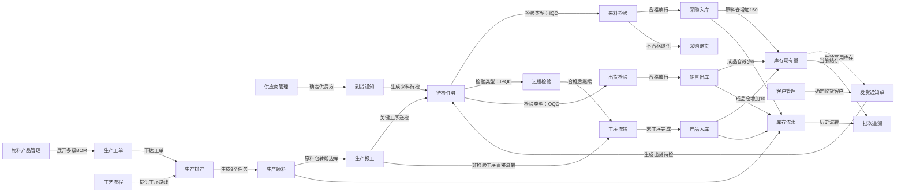
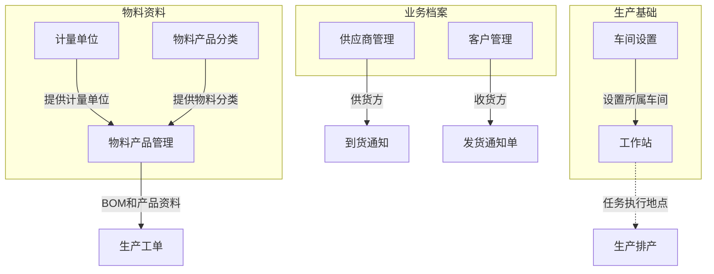
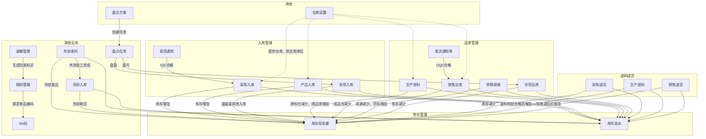
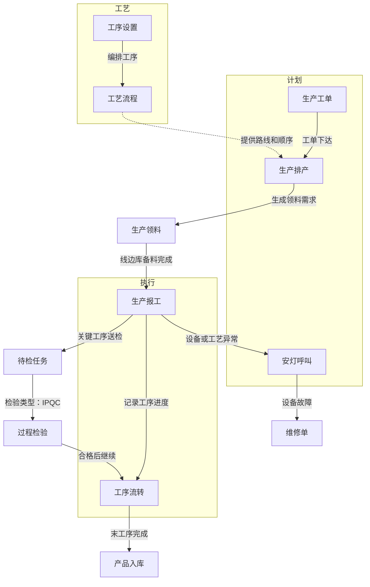
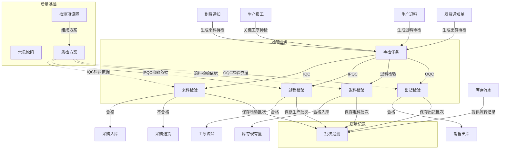
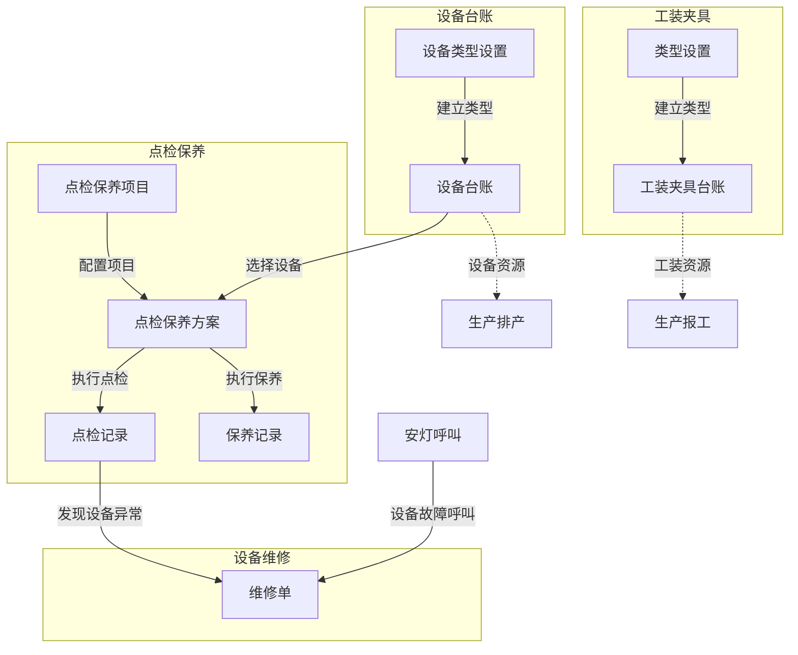
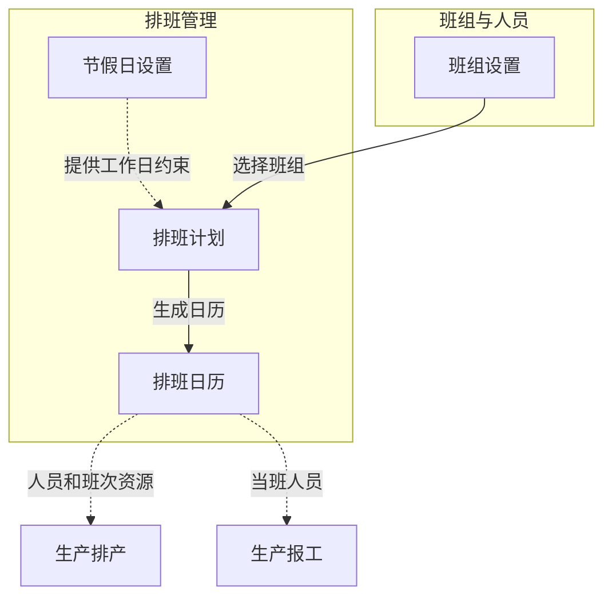
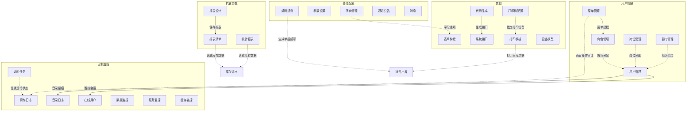
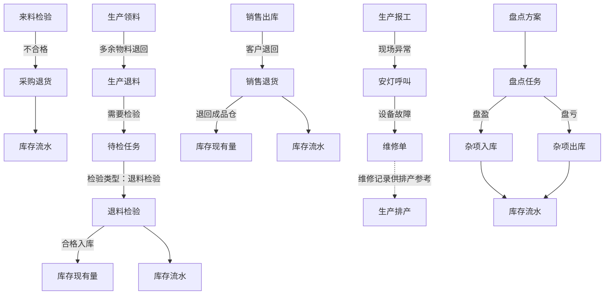
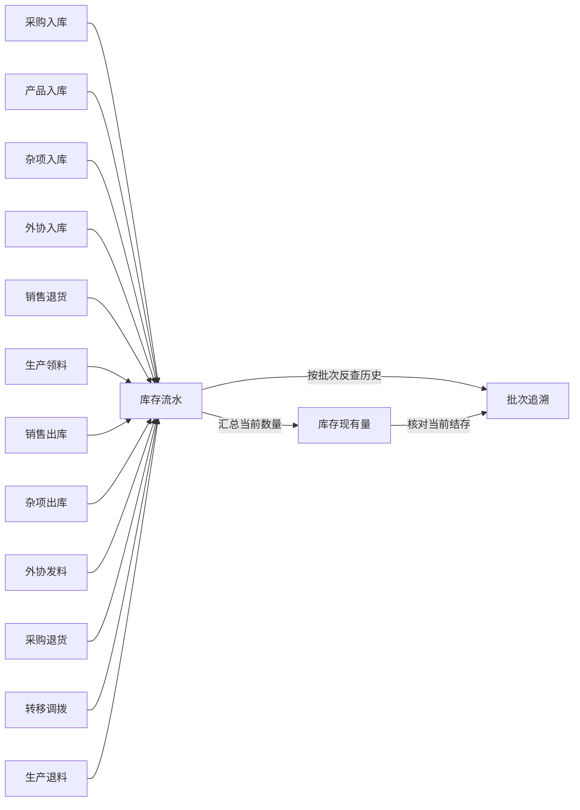

---
title: 红外测温枪 MES 系统侧边栏业务流程图（优化版）
source: 系统侧边栏菜单结构.md + rail-config.js + sys_menu
menu_policy: 所有流程节点只使用现有侧边栏菜单名称，不新增、不删减、不改名
counts: 一级域 8 个，二级分组 27 个，三级菜单 85 个
---

# 红外测温枪 MES 系统侧边栏业务流程图（优化版）

> **节点规则**：流程图中的矩形节点全部来自《系统侧边栏菜单结构.md》，严格保留现有菜单名称。业务状态、库存动作和放行条件只能写在箭头上，不作为新节点。  
> **箭头规则**：实线 `-->` 表示实际业务流转；虚线 `-.->` 表示基础配置、权限、资源或查询支撑；无可靠直接关系的菜单不强行连线。  
> **演示口径**：采购150件，生产10台，销售6台，成品仓结存4台，形成64条库存流水。

---

## 一、端到端核心业务流程

### 核心放行规则

1. `来料检验`合格后才能进入`采购入库`；不合格时进入`采购退货`。
2. `生产排产`完成后才能执行`生产领料`；领料到线边库后才能进行`生产报工`。
3. 关键工序的`生产报工`进入`待检任务`，由`过程检验`合格后继续`工序流转`。
4. `发货通知单`进入`待检任务`，由`出货检验`合格后执行`销售出库`。
5. 所有库存增减均写入`库存流水`，并可通过`批次追溯`反查来源。

---

## 二、首页

`首页`是登录后的系统入口，不直接产生业务单据。

---

## 三、主数据

### 连接说明

- `计量单位`、`物料产品分类`是`物料产品管理`的前置资料。
- `供应商管理`服务采购到货；`客户管理`服务发货和销售。
- `车间设置`和`工作站`为排产、领料、报工提供执行地点。

---

## 四、仓储

### 连接说明

- `仓库设置`只作为基础资料支撑，不直接生成业务单据。
- `盘点方案`生成`盘点任务`，盘盈进入`杂项入库`，盘亏进入`杂项出库`。
- `生产退料`需要质量判定时，进入质量域的`待检任务`和`退料检验`。
- 入库、出库、退货、调拨和外协业务都必须更新`库存现有量`并生成`库存流水`。

---

## 五、生产

### 连接说明

- `工序设置`和`工艺流程`先于`生产排产`配置。
- `生产工单`下达后，`生产排产`生成任务并触发`生产领料`。
- `生产报工`记录实际产量；关键工序经`过程检验`合格后继续`工序流转`。
- `工序流转`完成末工序后进入`产品入库`。
- 生产现场异常通过`安灯呼叫`联动现有菜单`维修单`。

---

## 六、质量

### 连接说明

- `待检任务`是四类检验业务的统一入口，不新增其他待检节点。
- IQC不合格进入`采购退货`，不连接`退料检验`。
- `退料检验`由`生产退料`触发。
- `出货检验`由`发货通知单`触发，合格后放行`销售出库`。
- 不合格时停留在对应检验菜单中等待处置，不虚构侧边栏中不存在的处理菜单。

---

## 七、设备

### 连接说明

- `设备台账`和`点检保养项目`共同形成`点检保养方案`。
- 方案执行后分别产生`点检记录`和`保养记录`。
- 点检或安灯发现的设备故障进入`维修单`。
- 设备和工装仅作为生产资源支撑，不增加侧边栏中不存在的菜单节点。

---

## 八、班组排班

### 连接说明

- `班组设置`和`节假日设置`共同支撑`排班计划`。
- `排班计划`生成`排班日历`，为`生产排产`和`生产报工`提供人员、班次信息。

---

## 九、系统

### 连接说明

- `菜单管理`授权给`角色管理`，角色再分配给`用户管理`。
- `部门管理`和`岗位管理`为用户提供组织、岗位信息。
- `字典管理`、`参数设置`和`编码规则`支撑业务页面，但不作为业务单据节点。
- `操作日志`、`登录日志`、`在线用户`、`数据监控`、`服务监控`和`缓存监控`用于运行审计与监控。
- `报表设计`保存后进入`报表清单`；`统计报表`和表格报表读取现有业务数据。

---

## 十、异常与逆向业务闭环

---

## 十一、库存与批次闭环

库存闭环要求：

- 每次库存增加、减少或库位转移都生成`库存流水`。
- `库存现有量`只表示当前结存，历史变化统一从`库存流水`查询。
- `批次追溯`同时使用当前库存和历史流水完成正向、反向追溯。

---

## 十二、菜单覆盖核对

| 一级域 | 二级分组 | 三级菜单 |
|---|---|---|
| 首页（1） | 首页 | 首页 |
| 主数据（7） | 物料资料 | 物料产品管理、物料产品分类、计量单位 |
|  | 业务档案 | 客户管理、供应商管理 |
|  | 生产基础 | 车间设置、工作站 |
| 仓储（22） | 库存管理 | 库存现有量、库存流水 |
|  | 入库管理 | 采购入库、到货通知、产品入库、杂项入库 |
|  | 出库管理 | 生产领料、发货通知单、销售出库、转移调拨、杂项出库 |
|  | 退料退货 | 采购退货、生产退料、销售退货 |
|  | 其他业务 | 盘点任务、装箱管理、赋码管理、SN码、外协发料、外协入库 |
|  | 其他 | 仓库设置、盘点方案 |
| 生产（7） | 计划 | 生产工单、生产排产、安灯呼叫 |
|  | 工艺 | 工序设置、工艺流程 |
|  | 执行 | 生产报工、工序流转 |
| 质量（9） | 质量基础 | 常见缺陷、检测项设置、质检方案 |
|  | 检验业务 | 待检任务、来料检验、过程检验、退料检验、出货检验 |
|  | 质量记录 | 批次追溯 |
| 设备（9） | 设备台账 | 设备类型设置、设备台账 |
|  | 点检保养 | 点检保养项目、点检保养方案、点检记录、保养记录 |
|  | 设备维修 | 维修单 |
|  | 工装夹具 | 类型设置、工装夹具台账 |
| 班组排班（4） | 班组与人员 | 班组设置 |
|  | 排班管理 | 排班计划、节假日设置、排班日历 |
| 系统（26） | 用户权限 | 部门管理、岗位管理、角色管理、用户管理、菜单管理 |
|  | 基础配置 | 字典管理、参数设置、通知公告、编码规则、消息 |
|  | 日志监控 | 操作日志、登录日志、在线用户、定时任务、数据监控、服务监控、缓存监控 |
|  | 扩展功能 | 统计报表、报表清单、报表设计 |
|  | 其他 | 表单构建、代码生成、系统接口、打印机配置、打印模板、设备模型 |

合计：一级域8个，二级分组27个，三级菜单85个。所有名称均与《系统侧边栏菜单结构.md》保持一致。

