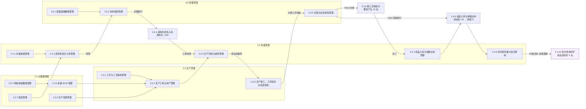
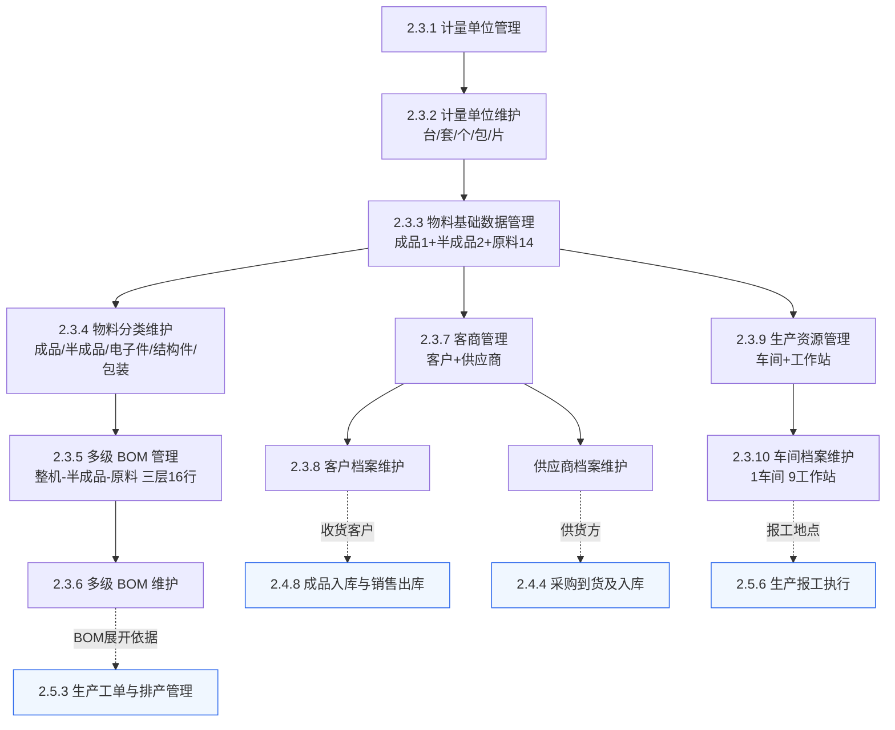
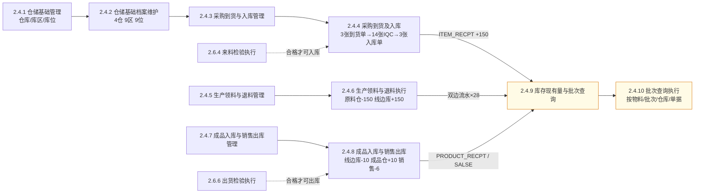
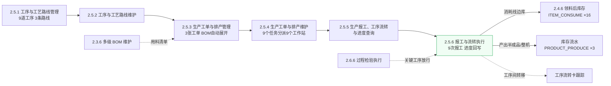
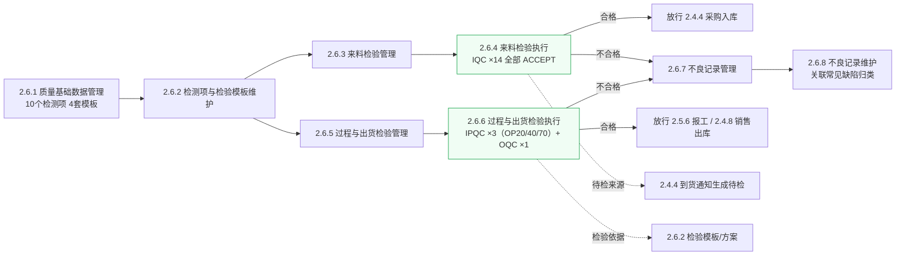
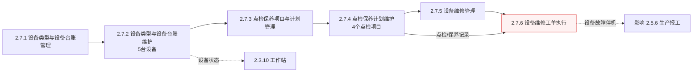
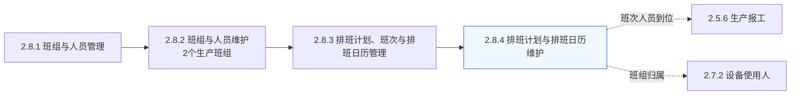
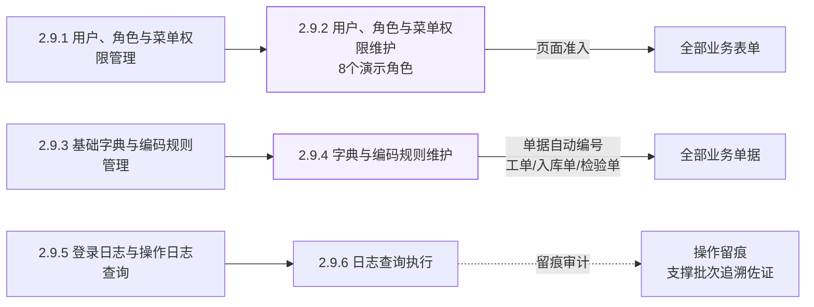

# 红外测温枪 MES 系统 — 业务流程图（按需求文档三级标题）

> **节点说明**：图中每个节点 = 《红外测温枪MES系统_软件需求规格说明书》的**三级标题**（保留原文编号与标题）；**箭头 = 业务流转顺序**，箭头文字为流转条件或库存动作。
> **结构规律**：文档中每个业务域均为「××管理（业务流程与规则）→ ××维护（表单操作层）」成对出现，流程图中按"先管理定义、后维护执行"连线。
> **范围**：需求文档第 2 章功能性需求的 2.3~2.9 共 50 个三级标题；口径与《红外测温枪MES系统业务流程.md》一致（生产 10 台、销售 6 台、结存 4 台、64 条流水）。

---

## 一、端到端主流程（跨业务域总览）

> 按文档业务域顺序：2.3 主数据 → 2.4 仓储 → 2.5 生产 → 2.6 质量 → 回到 2.4 成品与销售 → 2.4.9 追溯。

---

## 二、2.3 主数据管理（10 个三级标题）

> 基础档案域：先定义（管理），后录入（维护）；向下支撑工单、到货、检验等所有单据。

---

## 三、2.4 仓储管理（10 个三级标题）

> 仓储域内部主链：基础档案 → 到货入库 → 领料退料 → 成品入库与销售出库 → 库存查询。

---

## 四、2.5 生产管理（6 个三级标题）

> 生产域主链：工艺定义 → 工单排产 → 报工流转与进度。

---

## 五、2.6 质量管理（8 个三级标题）

> 质量域主链：检验基础 → IQC（入库前）→ IPQC/OQC（过程与出货）→ 不良记录闭环。

---

## 六、2.7 设备管理（6 个三级标题）

> 设备域主链：台账 → 点检保养 → 维修，为生产执行提供设备可用性保障。

---

## 七、2.8 班组排班管理（4 个三级标题）

> 人员域主链：班组 → 排班 → 日历，回答"谁来上工"。

---

## 八、2.9 系统管理与追溯（6 个三级标题）

> 系统域：权限是所有页面的准入门槛；编码规则为全部单据编号；日志记录全程操作。

---

## 九、三级标题 ↔ 系统表单对照表

> 每个三级标题在运行系统（http://localhost/ 侧边栏）中的落点。

| 三级标题 | 系统表单/页面 | 侧边栏位置 | 路由 |
|---|---|---|---|
| 2.3.1 计量单位管理 | 计量单位 | 主数据 / 物料资料 | `/mes/md/unitmeasure` |
| 2.3.2 计量单位维护 | 计量单位（CRUD） | 主数据 / 物料资料 | `/mes/md/unitmeasure` |
| 2.3.3 物料基础数据管理 | 物料产品管理 | 主数据 / 物料资料 | `/mes/md/mditem` |
| 2.3.4 物料分类维护 | 物料产品分类 | 主数据 / 物料资料 | `/mes/md/itemtype` |
| 2.3.5 多级 BOM 管理 | 物料产品管理-BOM 页签 | 主数据 / 物料资料 | `/mes/md/mditem` |
| 2.3.6 多级 BOM 维护 | BOM 明细维护 | 主数据 / 物料资料 | `/mes/md/mditem` |
| 2.3.7 客商管理 | 客户管理 + 供应商管理 | 主数据 / 业务档案 | `/mes/md/client`、`/mes/md/vendor` |
| 2.3.8 客户档案维护 | 客户管理 | 主数据 / 业务档案 | `/mes/md/client` |
| 2.3.9 生产资源管理 | 车间设置 + 工作站 | 主数据 / 生产基础 | `/mes/md/workshop`、`/mes/md/workstation` |
| 2.3.10 车间档案维护 | 车间设置 | 主数据 / 生产基础 | `/mes/md/workshop` |
| 2.4.1 仓储基础管理 | 仓库设置（含库区/库位） | 仓储 / 其他 | `/mes/wm/warehouse` |
| 2.4.2 仓储基础档案维护 | 仓库/库区/库位维护 | 仓储 / 其他 | `/mes/wm/warehouse` |
| 2.4.3 采购到货与入库管理 | 到货通知 + 采购入库 | 仓储 / 入库管理 | `/mes/wm/arrivalnotice`、`/mes/wm/itemrecpt` |
| 2.4.4 采购到货及入库 | 到货单/入库单执行 | 仓储 / 入库管理 | `/mes/wm/arrivalnotice` |
| 2.4.5 生产领料与退料管理 | 生产领料 + 生产退料 | 仓储 / 出库管理、退料退货 | `/mes/wm/issue`、`/mes/wm/rtissue` |
| 2.4.6 生产领料与退料执行 | 领/退料单执行 | 仓储 / 出库管理 | `/mes/wm/issue` |
| 2.4.7 成品入库与销售出库管理 | 产品入库 + 发货通知 + 销售出库 | 仓储 / 入库管理、出库管理 | `/mes/wm/productrecpt`、`/mes/wm/salesnotice`、`/mes/wm/productsales` |
| 2.4.8 成品入库与销售出库执行 | 入库单/出库单执行 | 仓储 / 出库管理 | `/mes/wm/productsales` |
| 2.4.9 库存现有量与批次查询 | 库存现有量 | 仓储 / 库存管理 | `/mes/wm/wmstock` |
| 2.4.10 批次查询执行 | 库存现有量（批次维度） | 仓储 / 库存管理 | `/mes/wm/wmstock` |
| 2.5.1 工序与工艺路线管理 | 工序设置 + 工艺流程 | 生产 / 工艺 | `/mes/pro/process`、`/mes/pro/proroute` |
| 2.5.2 工序与工艺路线维护 | 工序/路线维护 | 生产 / 工艺 | `/mes/pro/process` |
| 2.5.3 生产工单与排产管理 | 生产工单 + 生产排产 | 生产 / 计划 | `/mes/pro/workorder`、`/mes/pro/proschedule` |
| 2.5.4 生产工单与排产维护 | 工单/排产维护 | 生产 / 计划 | `/mes/pro/workorder` |
| 2.5.5 生产报工、工序流转与进度查询 | 生产报工 + 工序流转 | 生产 / 执行 | `/mes/pro/feedback`、`/mes/pro/procard` |
| 2.5.6 报工与流转执行 | 报工单执行 | 生产 / 执行 | `/mes/pro/feedback` |
| 2.6.1 质量基础数据管理 | 检测项设置 + 质检方案 | 质量 / 质量基础 | `/mes/qc/qcindex`、`/mes/qc/qctemplate` |
| 2.6.2 检测项与检验模板维护 | 检测项/方案维护 | 质量 / 质量基础 | `/mes/qc/qcindex` |
| 2.6.3 来料检验管理 | 来料检验 | 质量 / 检验业务 | `/mes/qc/iqc` |
| 2.6.4 来料检验执行 | IQC 检验单 | 质量 / 检验业务 | `/mes/qc/iqc` |
| 2.6.5 过程与出货检验管理 | 过程检验 + 出货检验 | 质量 / 检验业务 | `/mes/qc/ipqc`、`/mes/qc/oqc` |
| 2.6.6 过程与出货检验执行 | IPQC/OQC 检验单 | 质量 / 检验业务 | `/mes/qc/ipqc` |
| 2.6.7 不良记录管理 | 不良记录（常见缺陷归类） | 质量 / 质量基础 | `/mes/qc/qcdefect` |
| 2.6.8 不良记录维护 | 不良记录维护 | 质量 / 质量基础 | `/mes/qc/qcdefect` |
| 2.7.1 设备类型与设备台账管理 | 设备类型设置 + 设备台账 | 设备 / 设备台账 | `/mes/dv/machinerytype`、`/mes/dv/machinery` |
| 2.7.2 设备类型与设备台账维护 | 设备台账维护 | 设备 / 设备台账 | `/mes/dv/machinery` |
| 2.7.3 点检保养项目与计划管理 | 点检保养项目 + 点检保养方案 | 设备 / 点检保养 | `/mes/dv/dvsubject`、`/mes/dv/checkplan` |
| 2.7.4 点检保养计划维护 | 点检/保养计划执行 | 设备 / 点检保养 | `/mes/dv/checkplan` |
| 2.7.5 设备维修管理 | 维修单 | 设备 / 设备维修 | `/mes/dv/repair` |
| 2.7.6 设备维修工单执行 | 维修工单执行 | 设备 / 设备维修 | `/mes/dv/repair` |
| 2.8.1 班组与人员管理 | 班组设置 | 班组排班 / 班组与人员 | `/cal/team` |
| 2.8.2 班组与人员维护 | 班组/成员维护 | 班组排班 / 班组与人员 | `/cal/team` |
| 2.8.3 排班计划、班次与排班日历管理 | 排班计划 + 节假日设置 + 排班日历 | 班组排班 / 排班管理 | `/cal/plan`、`/cal/holiday`、`/cal/calendar` |
| 2.8.4 排班计划与排班日历维护 | 排班日历维护 | 班组排班 / 排班管理 | `/cal/calendar` |
| 2.9.1 用户、角色与菜单权限管理 | 用户/角色/菜单管理 | 系统 / 用户权限 | `/user/user`、`/user/role`、`/system/menu` |
| 2.9.2 用户、角色与菜单权限维护 | 权限分配执行 | 系统 / 用户权限 | `/user/role` |
| 2.9.3 基础字典与编码规则管理 | 字典管理 + 编码规则 | 系统 / 基础配置 | `/system/dict`、`/system/autocodeRule` |
| 2.9.4 字典与编码规则维护 | 字典项/编码规则维护 | 系统 / 基础配置 | `/system/autocodeRule` |
| 2.9.5 登录日志与操作日志查询 | 操作日志 + 登录日志 | 系统 / 日志监控 | `/system/log/operlog`、`/system/log/logininfor` |
| 2.9.6 日志查询执行 | 日志检索 | 系统 / 日志监控 | `/system/log/operlog` |

> 补充：库存流水的 8 类记录（`ITEM_RECPT`、`ITEM_ISSUE_OUT/IN`、`ITEM_CONSUME`、`PRODUCT_PRODUCE`、`PRODUCT_RECPT_OUT/IN`、`PRODUCT_SALSE`）全部落在「2.4.9 库存现有量与批次查询」对应的 **库存流水** 页面（`/mes/wm/transaction`）中查询，共 64 条。
