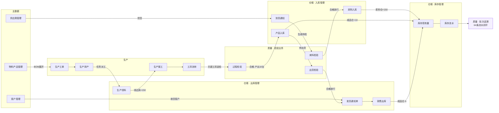
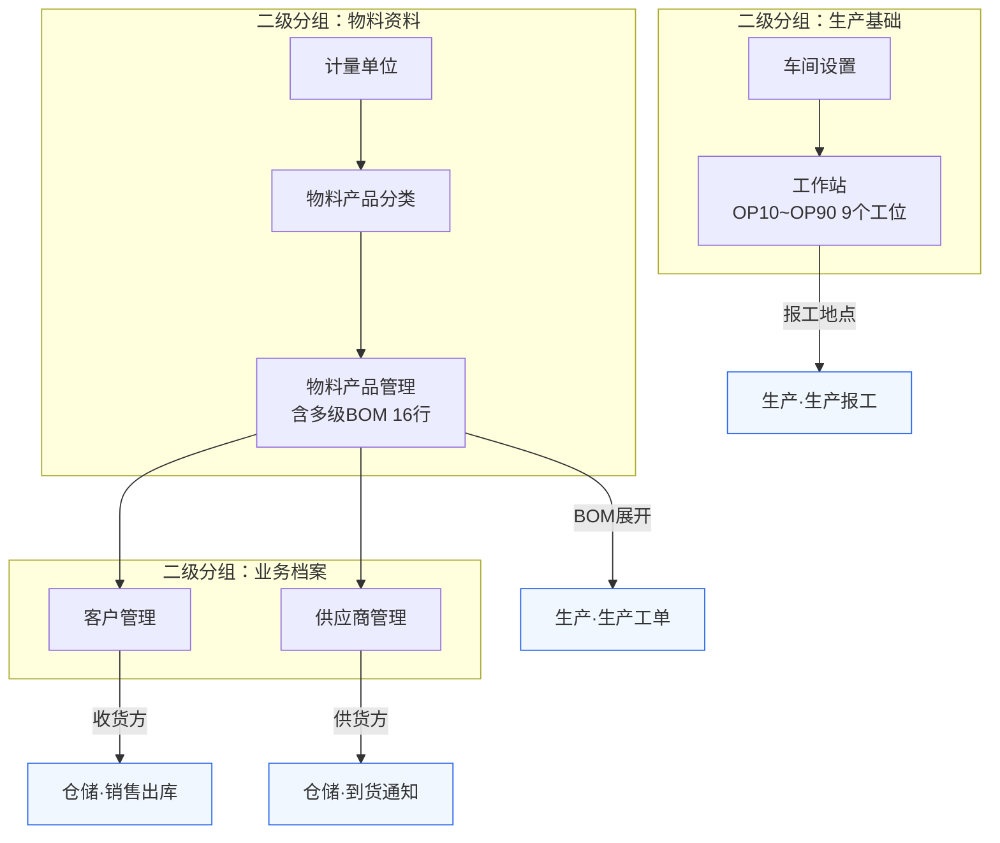
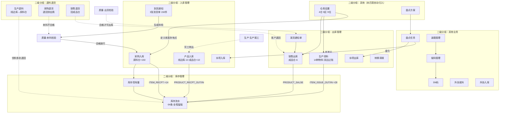
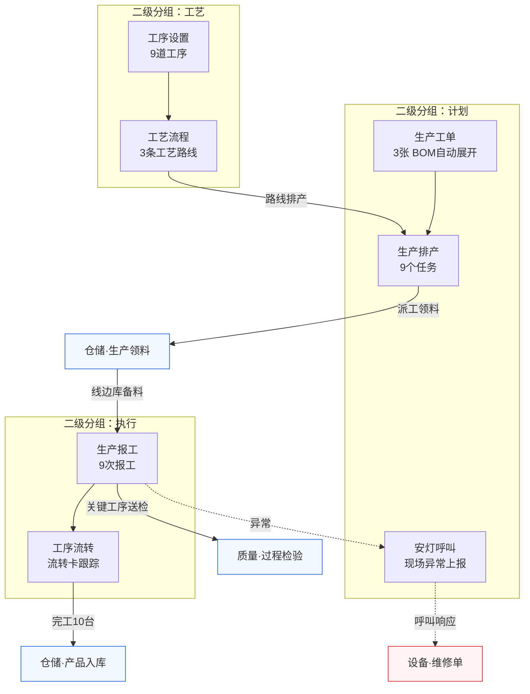
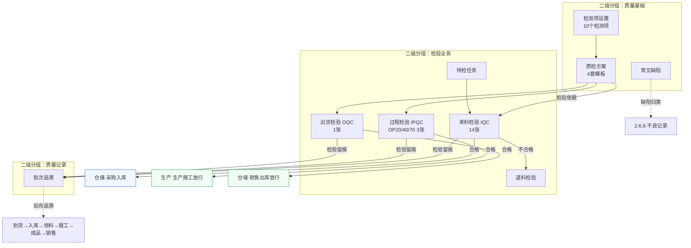
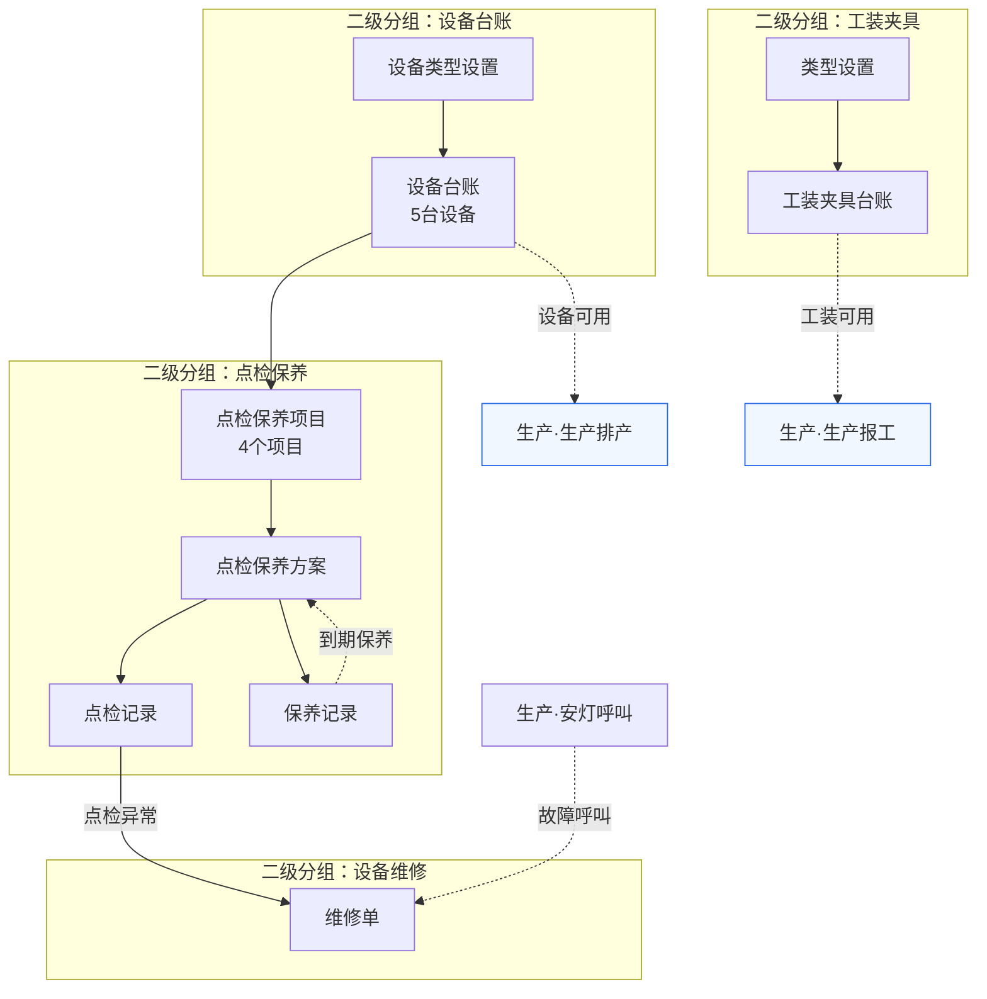
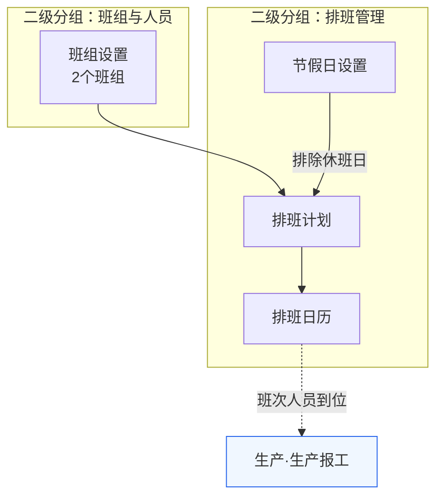
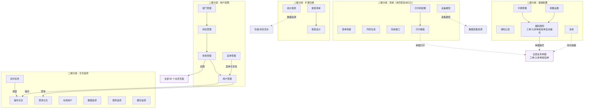

# 红外测温枪 MES 系统 — 侧边栏菜单业务流程图

> **节点口径**：与《系统侧边栏菜单结构.md》完全一致 —— 一级 = 左栏 8 个图标域，二级 = 域内分组（母目录），三级 = 组内菜单项；**85 个三级菜单全部入图，不增不漏**。
> **箭头含义**：实线 `-->` = 单据/数据的业务流转；虚线 `-.->` = 支撑、放行或联动关系；箭头文字为流转条件或库存动作。
> **阅读方式**：用支持 Mermaid 的工具打开（IDEA / VSCode / Typora）。演示数据口径：采购 150 件、生产 10 台、销售 6 台、成品仓结存 4 台、64 条库存流水。

---

## 一、端到端主流程总览（跨一级域）

> 主链：主数据 → 到货/IQC → 采购入库 → 工单排产 → 领料 → 报工 → IPQC → 成品入库 → OQC → 销售出库 → 库存追溯。



---

## 二、一级域：首页

> 仅 1 个菜单项：`/index` 系统首页，作为登录后的入口，不参与业务流转。


---

## 三、一级域：主数据（7 项）

> 基础档案准备顺序：物料资料 → 业务档案 → 生产基础；完成后才能开始采购与生产单据。



---

## 四、一级域：仓储（22 项）

> 仓储域业务顺序：仓库设置（基础）→ 入库管理 → 出库管理 → 退料退货 → 盘点与标识（其他业务）→ 库存查询。其余未分组项归入「其他」。



---

## 五、一级域：生产（7 项）

> 生产域顺序：计划（工单→排产→安灯）→ 工艺（工序→路线）→ 执行（报工→流转）。工艺与计划配合，执行落地。



---

## 六、一级域：质量（9 项）

> 质量域顺序：质量基础（检测项/方案/缺陷）→ 检验业务（待检→IQC/IPQC/OQC/退料检验）→ 质量记录（批次追溯）。



---

## 七、一级域：设备（9 项）

> 设备域顺序：设备台账 → 点检保养 → 维修 → 工装夹具，保障生产设备与工装可用。



---

## 八、一级域：班组排班（4 项）

> 人员域顺序：班组 → 排班计划 → 排班日历，节假日参与排班约束。



---

## 九、一级域：系统（26 项）

> 系统域：用户权限是全部页面的准入；基础配置（字典/编码规则）为单据编号；日志监控全程留痕；扩展功能提供报表与打印。



---

## 十、覆盖核对表

> 与《系统侧边栏菜单结构.md》逐域核对，85 项全部入图。

| 一级域 | 二级分组 | 三级菜单（图中节点） |
|---|---|---|
| 首页 | — | 首页 |
| 主数据（7） | 物料资料 | 物料产品管理、物料产品分类、计量单位 |
| | 业务档案 | 客户管理、供应商管理 |
| | 生产基础 | 车间设置、工作站 |
| 仓储（22） | 库存管理 | 库存现有量、库存流水 |
| | 入库管理 | 采购入库、到货通知、产品入库、杂项入库 |
| | 出库管理 | 生产领料、发货通知单、销售出库、杂项出库、转移调拨 |
| | 退料退货 | 生产退料、采购退货、销售退货 |
| | 其他业务 | 盘点任务、装箱管理、赋码管理、SN码、外协发料、外协入库 |
| | 其他 | 仓库设置、盘点方案 |
| 生产（7） | 计划 | 生产工单、生产排产、安灯呼叫 |
| | 工艺 | 工序设置、工艺流程 |
| | 执行 | 生产报工、工序流转 |
| 质量（9） | 质量基础 | 常见缺陷、检测项设置、质检方案 |
| | 检验业务 | 待检任务、来料检验、过程检验、退料检验、出货检验 |
| | 质量记录 | 批次追溯 |
| 设备（9） | 设备台账 | 设备类型设置、设备台账 |
| | 点检保养 | 点检保养项目、点检保养方案、点检记录、保养记录 |
| | 设备维修 | 维修单 |
| | 工装夹具 | 类型设置、工装夹具台账 |
| 班组排班（4） | 班组与人员 | 班组设置 |
| | 排班管理 | 排班计划、节假日设置、排班日历 |
| 系统（26） | 用户权限 | 部门管理、岗位管理、角色管理、用户管理、菜单管理 |
| | 基础配置 | 字典管理、参数设置、通知公告、编码规则、消息 |
| | 日志监控 | 操作日志、登录日志、在线用户、定时任务、数据监控、服务监控、缓存监控 |
| | 扩展功能 | 统计报表、报表清单、报表设计 |
| | 其他 | 表单构建、代码生成、系统接口、打印机配置、打印模板、设备模型 |

**主流程箭头链（演示主线）**：

```text
供应商管理 → 到货通知 → 来料检验(IQC) → 采购入库 → 库存现有量/库存流水
物料产品管理(BOM) → 生产工单 → 生产排产 → 生产领料 → 生产报工 → 过程检验(IPQC)
→ 产品入库 → 出货检验(OQC) → 发货通知单 → 销售出库 → 库存现有量 → 库存流水 → 批次追溯
```
