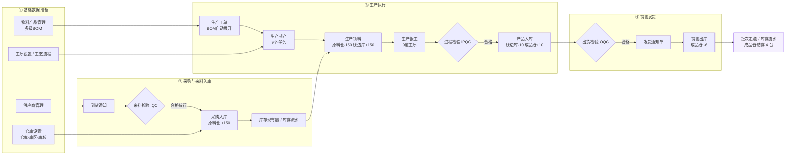
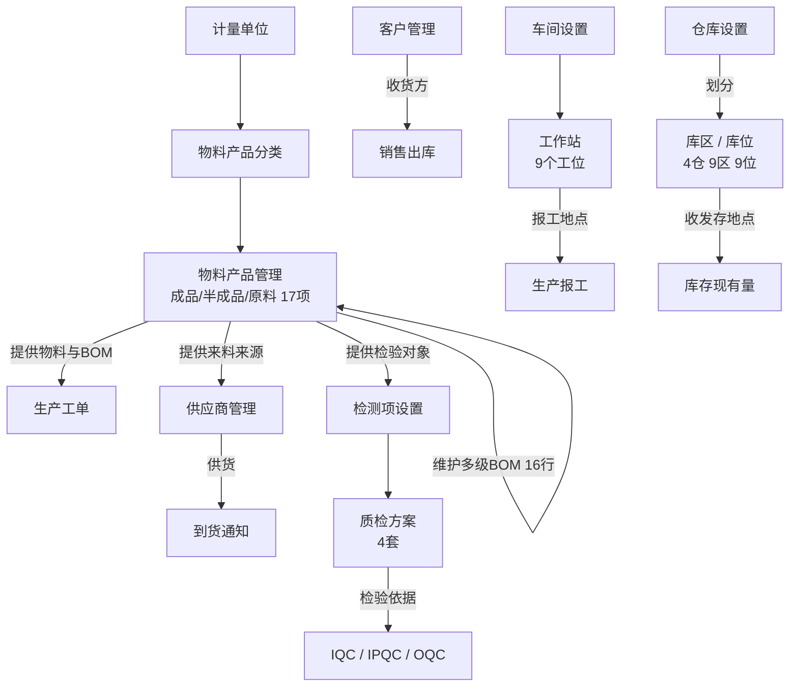
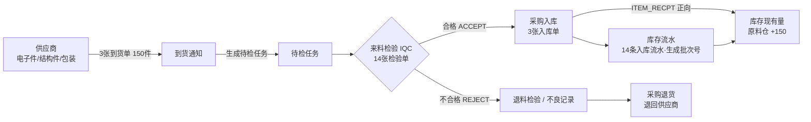
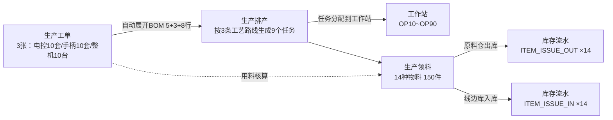
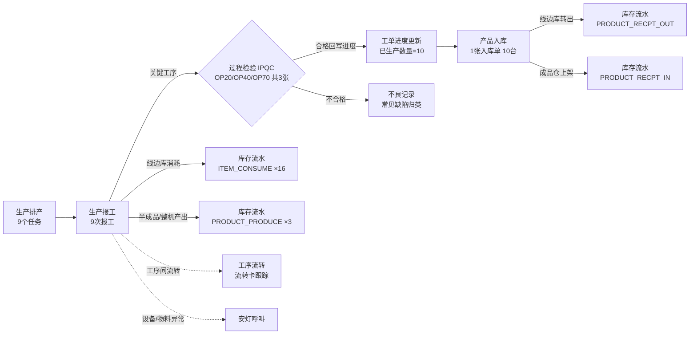
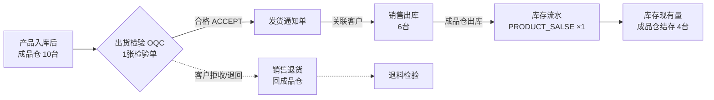
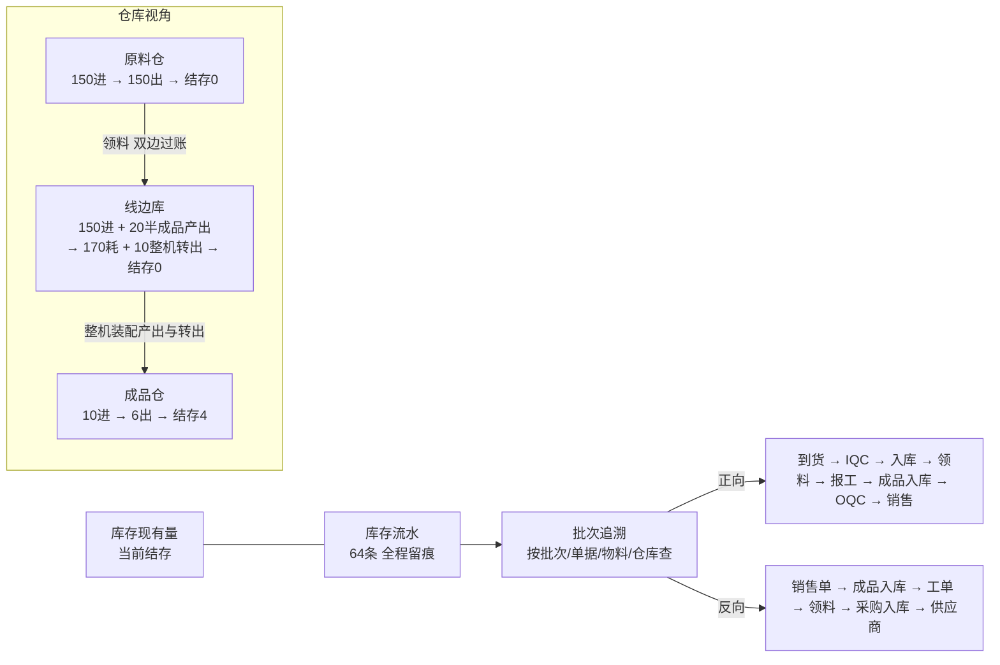
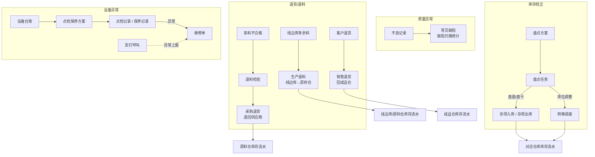
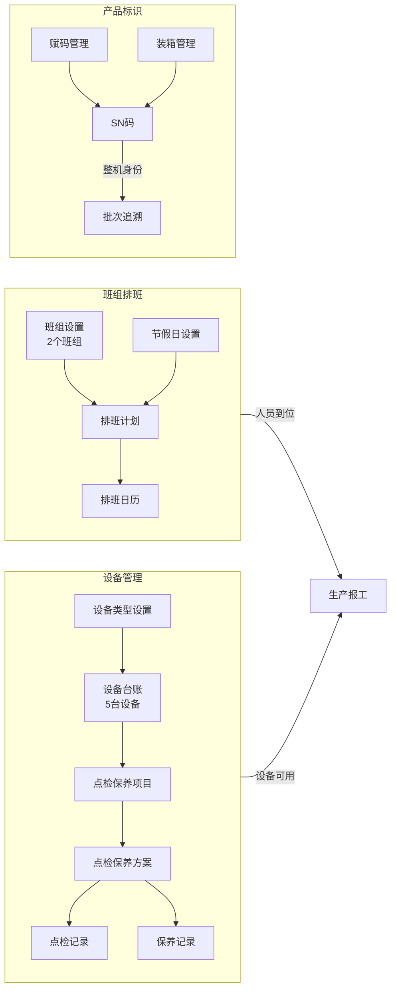

# 红外测温枪 MES 系统 — 表单业务流程图

> **节点说明**：图中每个节点 = 系统里的实际表单/页面（对应侧边栏三级菜单项）；**箭头 = 单据与数据的业务流向**，箭头上的文字为流转条件或库存动作。
> **数据口径**：与《红外测温枪MES系统业务流程.md》一致 —— 采购 150 件、生产 10 台、销售 6 台、成品仓结存 4 台、64 条库存流水。
> **使用方式**：用支持 Mermaid 的工具打开（IDEA / VSCode / Typora / docs 平台）即可看到图形。

---

## 一、端到端主流程总览

---

## 二、阶段一：基础数据准备

> 一切单据的前提：先有物料档案、BOM、工艺路线、仓库档案和往来单位。

---

## 三、阶段二：采购到货 → IQC → 采购入库

> 关键控制点：**IQC 合格是采购入库的前置条件**，不合格批次被阻断。

---

## 四、阶段三：生产工单 → 排产 → 领料

> 关键动作：工单保存即按 BOM 展开用料；排产把工单拆成任务落到工作站；领料完成**原料仓 → 线边库**的双边过账。

---

## 五、阶段四：报工 → IPQC → 成品入库

> 关键控制点：OP20 / OP40 / OP70 三个关键工序必须 IPQC 合格；报工同时产生**线边库消耗与产出**流水。

---

## 六、阶段五：OQC → 发货通知 → 销售出库

> 关键控制点：**OQC 合格是销售出库的前置条件**。

---

## 七、库存闭环与批次追溯

> 8 类流水、64 条记录，账实闭环；凭批次号可从销售一路反查到供应商。

---

## 八、异常与逆向流程

> 退货、退料、不良、盘点、设备维修等分支流程，同样全部落到库存流水。

---

## 九、辅助支撑流程（设备 / 班组 / 追溯标识）

---

## 十、表单与侧边栏菜单对照表

> 节点在系统中的实际位置（一级域 / 二级分组 / 三级菜单），方便演示时按图索骥。

| 表单节点 | 一级域 | 二级分组 | 完整路由 |
|---|---|---|---|
| 计量单位 | 主数据 | 物料资料 | `/mes/md/unitmeasure` |
| 物料产品分类 | 主数据 | 物料资料 | `/mes/md/itemtype` |
| 物料产品管理（BOM） | 主数据 | 物料资料 | `/mes/md/mditem` |
| 客户管理 | 主数据 | 业务档案 | `/mes/md/client` |
| 供应商管理 | 主数据 | 业务档案 | `/mes/md/vendor` |
| 车间设置 | 主数据 | 生产基础 | `/mes/md/workshop` |
| 工作站 | 主数据 | 生产基础 | `/mes/md/workstation` |
| 仓库设置 | 仓储 | 其他 | `/mes/wm/warehouse` |
| 到货通知 | 仓储 | 入库管理 | `/mes/wm/arrivalnotice` |
| 采购入库 | 仓储 | 入库管理 | `/mes/wm/itemrecpt` |
| 产品入库 | 仓储 | 入库管理 | `/mes/wm/productrecpt` |
| 杂项入库 | 仓储 | 入库管理 | `/mes/wm/miscrecpt` |
| 生产领料 | 仓储 | 出库管理 | `/mes/wm/issue` |
| 发货通知单 | 仓储 | 出库管理 | `/mes/wm/salesnotice` |
| 销售出库 | 仓储 | 出库管理 | `/mes/wm/productsales` |
| 转移调拨 | 仓储 | 出库管理 | `/mes/wm/transfer` |
| 杂项出库 | 仓储 | 出库管理 | `/mes/wm/miscissue` |
| 生产退料 | 仓储 | 退料退货 | `/mes/wm/rtissue` |
| 采购退货 | 仓储 | 退料退货 | `/mes/wm/rtvendor` |
| 销售退货 | 仓储 | 退料退货 | `/mes/wm/rtsales` |
| 盘点方案 | 仓储 | 其他 | `/mes/wm/stocktaking/stocktakingplan` |
| 盘点任务 | 仓储 | 其他业务 | `/mes/wm/stocktaking/stocktaking` |
| 装箱管理 | 仓储 | 其他业务 | `/mes/wm/package` |
| 赋码管理 | 仓储 | 其他业务 | `/mes/wm/barcode` |
| SN码 | 仓储 | 其他业务 | `/mes/wm/sn` |
| 外协发料 | 仓储 | 其他业务 | `/mes/wm/outsourceissue` |
| 外协入库 | 仓储 | 其他业务 | `/mes/wm/outsourcerecpt` |
| 库存现有量 | 仓储 | 库存管理 | `/mes/wm/wmstock` |
| 库存流水 | 仓储 | 库存管理 | `/mes/wm/transaction` |
| 生产工单 | 生产 | 计划 | `/mes/pro/workorder` |
| 生产排产 | 生产 | 计划 | `/mes/pro/proschedule` |
| 安灯呼叫 | 生产 | 计划 | `/mes/pro/andonrecord` |
| 工序设置 | 生产 | 工艺 | `/mes/pro/process` |
| 工艺流程 | 生产 | 工艺 | `/mes/pro/proroute` |
| 生产报工 | 生产 | 执行 | `/mes/pro/feedback` |
| 工序流转 | 生产 | 执行 | `/mes/pro/procard` |
| 常见缺陷 | 质量 | 质量基础 | `/mes/qc/qcdefect` |
| 检测项设置 | 质量 | 质量基础 | `/mes/qc/qcindex` |
| 质检方案 | 质量 | 质量基础 | `/mes/qc/qctemplate` |
| 待检任务 | 质量 | 检验业务 | `/mes/qc/pendinginspect` |
| 来料检验 IQC | 质量 | 检验业务 | `/mes/qc/iqc` |
| 过程检验 IPQC | 质量 | 检验业务 | `/mes/qc/ipqc` |
| 退料检验 | 质量 | 检验业务 | `/mes/qc/rqc` |
| 出货检验 OQC | 质量 | 检验业务 | `/mes/qc/oqc` |
| 批次追溯 | 质量 | 质量记录 | `/mes/qc/batchtrace` |
| 设备类型设置 | 设备 | 设备台账 | `/mes/dv/machinerytype` |
| 设备台账 | 设备 | 设备台账 | `/mes/dv/machinery` |
| 点检保养项目 | 设备 | 点检保养 | `/mes/dv/dvsubject` |
| 点检保养方案 | 设备 | 点检保养 | `/mes/dv/checkplan` |
| 点检记录 | 设备 | 点检保养 | `/mes/dv/checkrecord` |
| 保养记录 | 设备 | 点检保养 | `/mes/dv/maintenrecord` |
| 维修单 | 设备 | 设备维修 | `/mes/dv/repair` |
| 类型设置（工装） | 设备 | 工装夹具 | `/tm/tooltype` |
| 工装夹具台账 | 设备 | 工装夹具 | `/tm/tool` |
| 班组设置 | 班组排班 | 班组与人员 | `/cal/team` |
| 排班计划 | 班组排班 | 排班管理 | `/cal/plan` |
| 节假日设置 | 班组排班 | 排班管理 | `/cal/holiday` |
| 排班日历 | 班组排班 | 排班管理 | `/cal/calendar` |

---

## 十一、流程与单据数量对照（演示口径）

| 流程环节 | 生成单据 | 数量 | 库存流水类型 |
|---|---|---:|---|
| 采购到货 | 到货通知单 | 3 | — |
| 来料检验 | IQC | 14 | — |
| 采购入库 | 采购入库单 | 3 | `ITEM_RECPT` ×14 |
| 生产工单 | 生产工单 | 3 | — |
| 生产排产 | 生产任务 | 9 | — |
| 生产领料 | 领料单 | 3 | `ITEM_ISSUE_OUT/IN` 各×14 |
| 生产报工 | 报工单 | 9 | `ITEM_CONSUME` ×16、`PRODUCT_PRODUCE` ×3 |
| 过程检验 | IPQC | 3 | — |
| 成品入库 | 产品入库单 | 1 | `PRODUCT_RECPT_OUT/IN` 各×1 |
| 出货检验 | OQC | 1 | — |
| 销售出库 | 销售出库单 | 1 | `PRODUCT_SALSE` ×1 |
| **合计** | | | **64 条流水，全程可追溯** |
