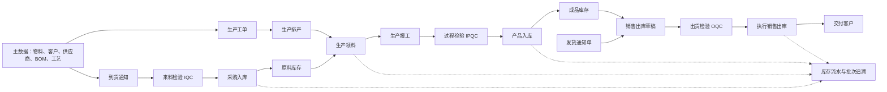

# 红外测温枪 MES：从基本事实理解业务流程与项目功能

> 阅读对象：希望理解系统业务、菜单和数据关系的项目成员、实施人员与开发人员。
> 资料基线：2026-10-28 的需求文档及当前工作区源码。工作区包含尚未提交的改造，运行环境是否已加载、数据库补丁是否已部署，需要另行核实。本文描述业务目标时不代表功能已全部实现。

## 一、先从几个基本事实出发

企业生产一台测温枪，需要先有物料、设备、人员和工艺，再将物料加工成产品，检验后交给客户。MES 要回答的核心问题是：**什么东西，在什么时间、什么地点，由谁依据什么要求处理，数量和质量如何，最终去了哪里。**

以下是理解系统的基本约束：

1. **实物和记录是两回事。** 保存一张单据只产生一条业务记录；货物真正入库、出库或转移，需要执行对应的库存动作。
2. **数量要能对账。** 同一种物料、同一单位、同一范围内，期末数量应能由期初数量和实际收发变化解释。不同物料、不同单位不能直接相加。
3. **质量状态决定能做什么。** 待检、合格、不合格分别代表不同的处理条件。待检草稿不等于合格结论；NG 不应作为合格品入库或发货。
4. **每一步要有来源和去向。** 入库行应能找到到货或产出来源；销售出库行应能找到客户、通知单、检验和批次；流水应能找到触发它的单据。
5. **同一个动作只能生效一次。** 重复点击、网络重试或多人同时操作，不应重复创建同一来源的草稿，也不应重复增减库存。
6. **人与权限决定谁能处理。** 系统可以根据规则准备草稿，但检验判定、审核、执行和异常处置仍属于有权限的岗位人员。
7. **历史必须可解释。** 已确认或执行单据保存当时的关键资料快照；后续基础资料变化不能悄悄改写历史。发现错误时通常通过退货、退料或盘点等业务纠正。

这些约束是业务设计原则。当前代码是否在每个入口都完整落实，需要通过测试和复审确认。

## 二、先认识系统里的几种“账”

| 对象 | 回答的问题 | 例子 |
|---|---|---|
| 主数据 | 这是什么、可以怎么用？ | 物料、产品、客户、供应商、工艺、工作站 |
| 业务单据 | 谁准备做什么、做到哪一步？ | 到货通知、检验单、领料单、销售出库单 |
| 库存现有量 | 某物料、某批次目前在什么位置、有多少？ | 原料仓某库位的主控板有 20 件 |
| 库存流水 | 一次真实库存动作让数量如何变化？ | 采购入库 +8、领料转出 −8 |
| 质量记录 | 按什么方案检查，结果如何？ | IQC 检测 10、合格 8、不合格 2 |
| 生产记录 | 哪张工单、哪道工序、哪位人员完成了多少？ | 工序任务、领料、报工和 IPQC |
| 批次与追溯 | 这批货来自哪里、经过哪些处理、去了哪里？ | 供应商批次 → 生产工单 → 成品批次 → 客户 |

**单据头、单据行和明细**可以理解为：单据头记录共同信息，例如供应商和日期；单据行记录每种物料及数量；明细记录实际库位、批次及分配数量。同一张入库单可以有多行，一行也可以分到多个库位或批次。

**草稿、提交、完成、执行**并非所有模块都使用完全相同的状态名称。理解时先问：是否只是保存？是否已经提交待检或审核？是否已经产生库存流水？具体按钮和状态以对应菜单为准。

## 三、把整个企业流程连起来



图展示**目标业务关系**，并不意味着每条箭头已完成自动联动。各环节还可能有人工确认、审核、免检、退货和异常处理。

销售链的口径为：**发货通知确认 → 销售出库草稿 → 拣货并提交待检 → OQC → 放行后执行销售出库**。流程图原文把 OQC 画在发货通知之前；计划书明确选择了上述更贴合当前销售单来源字段的实现顺序。

## 四、从头走一遍：采购和来料质量

### 4.1 建立供货关系

采购人员在**供应商管理**维护供应商；在**物料产品管理**维护物料、单位和分类。供应商、物料和采购信息用于到货单选择。

**到货通知**表达“供应商送来了什么、预计或实际接收多少”。它不是已经完成的库存入账。每个到货行应能区分是否需要来料检验。

### 4.2 提交待检与 IQC

提交到货通知后，需检行进入**待检任务**，并按目标设计形成逐行的 **IQC（Incoming Quality Control，来料检验）草稿**。质检人员依据检验方案录入检测数、合格数、不合格数和判定结果。

例如某行到货 10 件，检测 10 件，其中合格 8 件、不合格 2 件：

```text
检测数量 10 = 合格 8 + 不合格 2
可作为该行合格入库来源的数量最多为 8
尚未入库的 2 件 NG 不是正式库存，也不能作为库存出库扣减
```

同一到货通知可能包含多个物料行；每一行的质量和数量应独立核对。免检行按已配置的免检规则进入后续处理，不应伪造一张合格检验单。

### 4.3 采购入库与未入库退供

检验完成后，合格来源行进入**采购入库草稿**；仓管填写实际批次、仓库、库区、库位及上架数量。只有执行入库后，库存现有量才增加，系统才应写入入库流水。部分入库时，来源单是否完成应按各行已处理数量汇总。

不合格来料有两种不同情形：

- **未入库退供**：实物退回供应商，但未进入正式库存，所以不应扣减正式库存。
- **已入库采购退货**：货物已记入库存，再退回供应商时，需要引用来源与批次并扣减对应库存。

**当前实现提示：**工作区已有 PC/移动端 IQC 完成和采购入库的共享服务及一些验证；未入库退供与已入库退货双模式尚未完成。混合合格行与全 NG 行的接口级复测仍需确认。

## 五、从原料到成品：生产流程

### 5.1 先确定“做什么、怎么做”

**BOM（物料清单）**描述产品由哪些物料或半成品组成及用量；**工艺流程**描述产品经过哪些工序；**工作站**描述工序实际执行地点或资源。三者分别回答“用什么”“按什么顺序做”“在哪里做”。

**生产工单**确定产品、计划数量和交期。系统可根据产品 BOM 展开工单用料；**生产排产**再将工单安排到工序、时间和工作站，形成生产任务。已执行任务及历史工单不应因后续修改基础 BOM 而静默改变。

例如计划生产 10 台，若每台需 1 块主控板，则理论需求为 10 块。实际需求还可能受损耗、替代料和工艺配置影响，应以已确认的业务规则为准。

### 5.2 领料、报工和过程检验

**生产领料**把物料从原料仓转到线边库或生产使用地点。一次转移应同时解释转出和转入：

```text
原料仓 −10 块主控板
线边库 +10 块主控板
企业内部这次转移合计为 0；地点发生变化
```

**生产报工**记录任务或工序实际完成情况。关键工序如果要求检验，目标流程是在**待检任务**显示，并生成 **IPQC（In-Process Quality Control，过程检验）草稿**。IPQC 合格后，才能按规则放行后续产出并更新生产进度；不合格不能算作合格产出。

**工序流转**用于理解产品经过哪些工序和当前放行状态。**安灯呼叫**用于上报现场异常，例如设备故障；设备故障与维修单的关联属于目标联动，是否暂停任务由具体状态规则决定。

### 5.3 产品入库

末工序合格产出需要进入成品仓时，形成**产品入库草稿**；仓管确认成品批次和目的库位后执行。业务上可入库的依据应是**真实、已放行、尚未入库的合格产出**，不能把计划生产数量直接当作实际合格产量。半成品在内部线边库流转时，不应重复形成成品仓入库。

**当前实现提示：**已存在工单、BOM、排产、领料、报工和 IPQC 等代码，也有产品入库自动草稿代码；产品入库数量来源、末工序和分批批次处理仍需加强验证。IPQC 与工序流转卡的联动也尚未形成完整闭环。

## 六、从成品到客户：销售和出货质量

### 6.1 通知、草稿与拣货

**客户管理**维护收货客户；**发货通知单**描述要向谁发什么、发多少。通知确认后，目标流程生成关联的**销售出库草稿**。

仓管根据成品库存选择实际批次和库位，形成拣货明细。此时记录的是计划发哪些货；**尚未执行销售出库时，不应把成品库存视为已经扣减**。预占是否生效取决于具体实现，不能仅凭有拣货明细就假设已预占。

### 6.2 OQC 与执行出库

需检销售行提交待检后生成 **OQC（Outgoing Quality Control，出货检验）草稿**。质检合格并满足发货条件后，仓管推进单据至可执行状态，再执行销售出库，扣减成品库存并写流水。

例如成品仓有 10 台，合格放行并执行出库 6 台，在没有其他变化时，结存为 4 台。OQC NG 不应放行；部分合格只能按合格量出库，并保留对不合格部分的后续处理记录。

**当前实现提示：**PC 端已有销售草稿、OQC 草稿和 OQC 回写等代码；销售单 OQC 完成后仍有人工推进待执行的步骤。移动端销售待检建 OQC 草稿的一致性尚待补齐和复测。

## 七、逆向业务：发生问题时如何走回去

逆向业务不是简单删除原单；它应引用原业务、数量和批次，产生可解释的处理记录。

| 业务 | 发生场景 | 目标处理 |
|---|---|---|
| 生产退料 | 领料后多余或不再使用 | 关联原领料及批次；需检时进行 RQC，合格后从线边库退回原料仓 |
| 采购退货/退供 | 来料不合格或已入库物料退回 | 区分未入库退供和已入库退货，前者不扣正式库存，后者按库存批次扣减 |
| 销售退货 | 客户退回已发商品 | 引用原销售行、客户和批次，核对可退数量；实际收货确认后按规则增加库存 |
| 盘盈、盘亏 | 实物与系统现有量不一致 | 盘点差异确认后分别形成杂项入库或杂项出库草稿，执行后记录调整流水 |
| 外协收发 | 物料交由外部加工再收回 | 发料和收货分别记录来源、批次、数量及库存动作，控制超发、超收 |

RQC 指退料或退货检验。流程图中“来料 NG → 退料检验”的含义与计划书中的采购退供口径存在待确认之处，不能假定目前 RQC 已支持直接关联到货行。

## 八、侧边栏各业务域是做什么的

菜单名称以需求流程图为准。以下是业务用途，**不表示所有列出的自动关系均已实现**。

### 8.1 首页

首页是登录入口及系统概览，不是产生库存或质检结果的业务单据。

### 8.2 主数据：为后续单据提供可信选项

| 菜单 | 功能 |
|---|---|
| 计量单位、物料产品分类 | 约定数量单位和分类 |
| 物料产品管理 | 维护原料、半成品、成品和产品 BOM |
| 客户管理、供应商管理 | 维护销售收货方和采购供货方 |
| 车间设置、工作站 | 维护生产地点和执行资源 |

主数据变化通常影响后续新建业务，历史已确认单据应保留当时快照。

### 8.3 仓储：管理实物地点与数量

| 分组 | 菜单及作用 |
|---|---|
| 仓库基础 | 仓库设置：维护仓库、库区和库位 |
| 入库管理 | 到货通知、采购入库、产品入库、杂项入库 |
| 出库管理 | 生产领料、发货通知单、销售出库、杂项出库、转移调拨 |
| 退料退货 | 生产退料、采购退货、销售退货 |
| 其他业务 | 盘点方案、盘点任务、装箱管理、赋码管理、SN 码、外协发料、外协入库 |
| 库存查询 | 库存现有量、库存流水 |

SN 是单件序列号；批次是一组具有共同来源或生产属性的货物。一个批次可以包含多件产品，SN 用于进一步区分单件。

### 8.4 生产：管理计划与执行

生产工单确定目标；生产排产安排任务；工序设置和工艺流程定义加工步骤；生产报工与工序流转记录过程；安灯呼叫记录现场异常。

### 8.5 质量：定义标准、检验并追溯

常见缺陷、检测项设置和质检方案提供检验依据；待检任务是从来源业务汇集的工作台；来料检验 IQC、过程检验 IPQC、出货检验 OQC、退料检验 RQC 记录不同阶段的结果；批次追溯提供查询入口。

**待检任务是查询工作台，不应理解为另外一张必须单独造出的库存业务单。**同一来源行已有检验草稿时，应打开已有草稿，避免重复生成。

### 8.6 设备与工装

设备类型设置、设备台账维护设备资料；点检保养项目与方案规定检查或保养内容；点检记录、保养记录记录结果；维修单记录故障处理；工装夹具类型与台账管理生产工具。设备状态和任务排产之间的具体联动仍应以实际实现为准。

### 8.7 班组排班

班组设置定义人员组织，排班计划安排班次，节假日设置参与排班约束，排班日历展示已安排的信息。目标是供排产和报工选择当班人员；日历属于查询展示，不需要为展示额外创建一张日历业务单。

### 8.8 系统、报表与打印

部门、岗位、角色、用户、菜单管理负责身份和权限；字典、参数和编码规则影响新单选项及编号；通知公告和消息用于展示或提醒；登录日志、操作日志、在线用户、定时任务和监控记录或展示系统运行情况。

统计报表、报表清单和报表设计读取业务数据；打印机配置和打印模板用于打印。打印失败不应改变已经完成的库存过账。表单构建、代码生成、系统接口和设备模型属于扩展能力，应按实际配置和权限使用。

## 九、库存流水与批次追溯怎么读

一次真实库存动作通常要能回答：**谁、何时、基于哪张单、哪个物料、哪个批次、从哪里到哪里、增减多少**。库存现有量是结果，库存流水是解释结果的动作记录；不能仅凭单据状态推断库存已经变化。

计划书中的示例事务类型包括 `ITEM_RECPT`（采购入库）、`ITEM_ISSUE_OUT/IN`（领料双边动作）、`PRODUCT_RECPT_OUT/IN`（产品入库双边动作）、`PRODUCT_SALSE`（销售出库；拼写沿用项目已有类型）。实际类型和字段应以项目库存实现与流水数据为准。

理想追溯链：客户与销售出库 → 成品批次 → 产品入库与合格产出 → 工单、报工和 IPQC → 领料批次 → 原料采购入库、IQC 和供应商。多种原料组成一种成品时，追溯是多对多关系，需要真实来源关联支持，不能仅靠批次名称猜测。

**当前实现提示：**现有批次页面可查询批次基础线索，跨采购、生产和销售的完整链式聚合仍需完善。

## 十、用一组数字把主链串起来

需求资料给出一组演示口径：采购原料共 150 件、生产成品 10 台、销售 6 台、成品仓结存 4 台。这个示例用于理解，**150 件原料与 10 台成品属于不同物料和单位，不能直接相减或等同**。

1. 供应商送来若干原料，总计 150 件；每种物料分别记录到货和 IQC。
2. 合格部分按批次、库位入原料仓。若存在 NG，未入库 NG 不进入原料仓数量。
3. 为 10 台测温枪创建工单，按 BOM 和工艺形成生产任务。
4. 领料从原料仓转入线边库；报工和必要的 IPQC 记录加工及放行结果。
5. 确认实际合格成品 10 台后，按批次执行成品入库，成品仓增加 10 台。
6. 发货通知形成销售草稿；OQC 放行后执行出库 6 台。若没有其他变动，成品仓剩 4 台。
7. 从销售出库单与成品批次回查生产和采购记录，解释来源、质量和数量。

“64 条流水”是需求资料所列的演示数据规模，不是每次业务必须产生的固定数量。实际流水条数取决于单据行、批次、库位及库存事务拆分。

## 十一、当前项目状态与学习时应注意的边界

截至本文基线，当前工作区已经有采购、IQC、销售/OQC、排产、领料、报工及部分自动草稿代码，也有尚未提交的采购质量与产品入库改造。具体状态可能随着其他 Agent 的工作继续变化。

以下事项应理解为**尚待完成或独立验证**，不能当作已交付事实：

- 采购退供/采购退货双模式；混合合格与全 NG 的完整真实接口回归。
- 产品入库从真实末工序、合格产出、批次和累计已入库量推导可入库数量。
- 采购入库提交后的领料草稿失败、回滚、重试和并发等完整链路验证。
- 移动端销售待检与 PC 的自动建 OQC 草稿一致性。
- RQC 自动草稿、盘点差异自动调整草稿、外协来源、SN 绑定、设备异常维修和完整链式追溯等。

学习建议：先按本文主链理解实物和数量如何变化，再打开相应菜单看单据状态和来源字段，最后用库存流水与批次核对结果。对“目标应有能力”和“当前系统实际能力”分别记录。

## 十二、参考资料与代码入口

- 业务目标：[表单联动改进计划书](<C:/Users/LEnovo/Downloads/表单联动改进计划书.md>)、[系统侧边栏业务流程图](<C:/Users/LEnovo/Downloads/系统侧边栏业务流程图.md>)。
- 项目核对记录：[表单联动核对清单](表单联动核对清单.md)、[表单联动改造交付说明](表单联动改造交付说明-20261028.md)。这些记录可能早于最新代码，应结合当前工作区复核。
- 采购与 IQC：[采购入库业务服务](backend/ktg-mes/ktg-mes/src/main/java/com/ktg/mes/wm/service/impl/ItemRecptWorkflowService.java)、[IQC 完成服务](backend/ktg-mes/ktg-mes/src/main/java/com/ktg/mes/qc/service/impl/QcIqcCompletionService.java)。
- 生产与成品：[领料草稿联动](backend/ktg-mes/ktg-mes/src/main/java/com/ktg/mes/linkage/IssueDraftLinkageService.java)、[产品入库草稿联动](backend/ktg-mes/ktg-mes/src/main/java/com/ktg/mes/linkage/ProductReceiptLinkageService.java)。
- 销售与质量：[销售出库控制器](backend/ktg-mes/ktg-mes/src/main/java/com/ktg/mes/wm/controller/WmProductSalesController.java)、[OQC 服务](backend/ktg-mes/ktg-mes/src/main/java/com/ktg/mes/qc/service/impl/QcOqcServiceImpl.java)。
