# 红外测温枪 MES 系统业务流程

> 文档用途：本文件同时作为项目正式业务流程说明和答辩现场演示手册。  
> 适用系统：红外测温枪 MES 系统  
> 演示口径：生产 10 台、销售 6 台、成品仓结存 4 台  
> 更新时间：2026-10-25

---

# 第一部分：正式业务流程说明

## 1. 文档目的

本文说明红外测温枪 MES 系统的业务边界、基础数据、产品结构、生产流程、质量控制、库存联动和单据追溯规则，用于：

- 指导业务人员理解系统操作顺序；
- 指导开发和测试人员核对模块关系；
- 证明需求规格、系统功能与实际业务流程相互对应；
- 为现场答辩提供统一的数据口径和操作依据。

## 2. 系统范围

系统以红外测温枪 `TG-FG-001` 为自定义产品，覆盖从原材料采购到销售发货的完整生命周期：

```text
基础数据准备
  → 采购到货
  → 来料检验（IQC）
  → 原材料入库
  → 生产工单与 BOM 展开
  → 排产与生产领料
  → 工序报工与过程检验（IPQC）
  → 成品入库
  → 出货检验（OQC）
  → 销售出库
  → 批次与库存流水追溯
```

## 3. 角色与职责

| 角色 | 演示账号 | 主要职责 |
|---|---|---|
| 系统管理员 | `admin` | 系统配置、用户权限、全模块维护 |
| 工艺员 | `craftsman` | 物料产品、BOM、工序、工艺路线维护 |
| 计划员 | `planner` | 创建生产工单、排产、进度跟踪 |
| 仓库员 | `warehouse` | 采购入库、生产领退料、成品入库、销售出库 |
| 生产操作员 | `operator` | 生产任务执行和报工 |
| 质检员 | `inspector` | IQC、IPQC、OQC 检验和质量判定 |
| 设备员 | `equipment` | 设备台账、点检、保养和维修 |
| 班组长 | `teamleader` | 班组成员、班次和排班计划管理 |

演示账号初始密码统一为 `admin123`。

## 4. 六大业务模块

| 模块 | 核心功能 | 主要输出 |
|---|---|---|
| 主数据 | 计量单位、物料产品、客户、供应商、车间、工作站 | 产品、物料和组织基础档案 |
| 仓储管理 | 仓库、库区、库位、采购入库、领退料、成品入库、销售出库、库存查询 | 库存现有量、批次、库存流水 |
| 生产管理 | 工单、工序、工艺路线、排产、任务、报工 | 工单进度、任务进度、产出记录 |
| 质量管理 | 检测项、检验方案、IQC、IPQC、OQC、不良记录 | 检验结果和放行状态 |
| 设备管理 | 设备类型、设备台账、点检保养项目、计划、记录、维修 | 设备状态和维护记录 |
| 班组排班 | 班组、成员、排班计划、班次、日历 | 人员班次和生产日历 |

## 5. 红外测温枪产品结构

### 5.1 产品和物料

系统共建立 17 个红外测温枪业务节点：

- 成品 1 种：红外测温枪整机；
- 自制半成品 2 种：电控预装件、手柄预装件；
- 外购物料 14 种：电子件、结构件和包装材料。

| 编码 | 名称 | 类型 | 单位 |
|---|---|---|---|
| `TG-FG-001` | 红外测温枪整机 | 成品 | 台 |
| `TG-SF-001` | 测温显示电控预装件 | 自制半成品 | 套 |
| `TG-SF-002` | 扳机与侧键手柄预装件 | 自制半成品 | 套 |
| `TG-EL-001` | 主控 PCBA | 外购物料 | 个 |
| `TG-EL-002` | 红外传感器模块 | 外购物料 | 个 |
| `TG-EL-003` | 显示组件 | 外购物料 | 个 |
| `TG-EL-004` | 三键按键板 | 外购物料 | 个 |
| `TG-EL-005` | 蜂鸣器 | 外购物料 | 个 |
| `TG-EL-006` | 电池 | 外购物料 | 节 |
| `TG-ST-001` | 上壳 | 外购物料 | 个 |
| `TG-ST-002` | 下壳 | 外购物料 | 个 |
| `TG-ST-003` | 扳机组件 | 外购物料 | 个 |
| `TG-ST-004` | 红外透镜 | 外购物料 | 个 |
| `TG-ST-005` | 螺丝包 | 外购物料 | 包 |
| `TG-ST-006` | 防震泡棉 | 外购物料 | 片 |
| `TG-PK-001` | 说明书 | 外购物料 | 份 |
| `TG-PK-002` | 彩盒包装 | 外购物料 | 个 |

### 5.2 多级 BOM

红外测温枪采用三层产品结构，共 16 行 BOM。整机直属组成 8 项，多级展开后包含 14 种外购物料，满足“原材料不少于 6 种、BOM 分项不少于 10 项”的要求。

```text
红外测温枪整机 TG-FG-001
├─ 测温显示电控预装件 TG-SF-001 ×1
│  ├─ 主控 PCBA ×1
│  ├─ 红外传感器模块 ×1
│  ├─ 显示组件 ×1
│  ├─ 蜂鸣器 ×1
│  └─ 红外透镜 ×1
├─ 扳机与侧键手柄预装件 TG-SF-002 ×1
│  ├─ 三键按键板 ×1
│  ├─ 电池 ×2
│  └─ 扳机组件 ×1
├─ 上壳 ×1
├─ 下壳 ×1
├─ 螺丝包 ×1
├─ 防震泡棉 ×1
├─ 说明书 ×1
└─ 彩盒包装 ×1
```

该结构不是“刀头加刀柄”式的简单拼装，而是包含两个自制半成品、电子件、结构件和包装材料的多层依赖关系。

## 6. 工艺路线

| 工艺路线 | 工序 | 质量控制点 |
|---|---|---|
| 电控预装路线 `TG-RT-EC` | OP10 电控件预装 → OP20 电控件通电测试 | OP20 执行 IPQC |
| 手柄预装路线 `TG-RT-HD` | OP30 手柄件预装 → OP40 手柄件功能测试 | OP40 执行 IPQC |
| 整机装配路线 `TG-RT-FG` | OP50 总装 → OP60 功能测试 → OP70 温度校准 → OP80 出货检验 → OP90 包装入库 | OP70 执行 IPQC，销售前执行 OQC |

系统共配置 9 道工序和 9 个对应工作站。

## 7. 端到端业务流程

```mermaid
flowchart LR
    A[采购到货<br/>3张到货单] --> B[来料检验 IQC<br/>14张检验单]
    B -->|合格放行| C[采购入库<br/>原料仓增加150]
    C --> D[创建3张生产工单<br/>自动展开16行多级BOM]
    D --> E[排产<br/>生成9个生产任务]
    E --> F[生产领料<br/>原料仓-150 / 线边库+150]
    F --> G[9道工序报工]
    G --> H[过程检验 IPQC<br/>3张检验单]
    H -->|合格| I[生产产出<br/>整机10台]
    I --> J[成品入库<br/>成品仓+10]
    J --> K[出货检验 OQC<br/>合格放行]
    K --> L[销售出库6台]
    L --> M[成品仓结存4台<br/>64条库存流水可追溯]
```



## 8. 分阶段业务说明

### 8.1 采购到货与 IQC

三家供应商分别提供电子件、结构件和包装材料：

| 到货类别 | 物料种类 | 到货数量合计 |
|---|---:|---:|
| 电子件 | 7 | 80 |
| 结构件 | 5 | 50 |
| 包装材料 | 2 | 20 |
| 合计 | 14 | 150 |

业务规则：

1. 仓库员创建采购到货单和到货明细；
2. 系统为需要检验的到货行生成 IQC 业务依据；
3. 质检员依据检验方案完成 14 张 IQC；
4. 检验结果为 `ACCEPT` 后才能继续采购入库；
5. 不合格批次必须阻断入库或进入不良处理流程。

### 8.2 原材料入库

IQC 合格后创建 3 张采购入库单，执行入库后：

- 原料仓增加 14 种物料，共 150 件/套；
- 每种物料生成独立批次号；
- 库存流水记录来源单据、批次、仓库、库区、库位和数量；
- 流水方向为 `ITEM_RECPT`，入库标志为正向。

### 8.3 生产工单与 BOM 展开

系统创建 3 张生产工单：

| 产品 | 计划数量 | 自动展开 BOM |
|---|---:|---:|
| 测温显示电控预装件 | 10 套 | 5 行 |
| 扳机与侧键手柄预装件 | 10 套 | 3 行 |
| 红外测温枪整机 | 10 台 | 8 行 |

工单保存后关联产品、工艺路线和 BOM，形成计划用料依据。

### 8.4 排产与生产领料

三张工单根据三条工艺路线生成 9 个生产任务，并分配至 9 个工作站。

生产领料共覆盖 14 种外购物料：

| 领料用途 | 数量合计 | 库存变化 |
|---|---:|---|
| 电控预装 | 50 | 原料仓 -50，线边库 +50 |
| 手柄预装 | 40 | 原料仓 -40，线边库 +40 |
| 整机结构件和包装材料 | 60 | 原料仓 -60，线边库 +60 |
| 合计 | 150 | 原料仓 -150，线边库 +150 |

每项领料产生一条原料仓出库流水和一条线边库入库流水，共 28 条领料双边流水。

### 8.5 生产报工与 IPQC

操作员按 9 道工序完成报工：

- 电控预装路线报工 2 次，产出 10 套电控预装件；
- 手柄预装路线报工 2 次，产出 10 套手柄预装件；
- 整机路线报工 5 次，产出 10 台红外测温枪；
- OP20、OP40、OP70 三个关键工序各生成 1 张 IPQC；
- IPQC 合格后回写报工和工单进度；
- 三张工单的已生产数量均更新为 10。

报工会同步处理线边库消耗和半成品/成品产出。总消耗记录 16 条，总产出记录 3 条。

### 8.6 成品入库

整机生产完成后创建产品入库单：

1. 从虚拟线边库选择整机批次；
2. 上架到成品仓、成品区、成品库位；
3. 核对入库数量为 10；
4. 执行入库后，线边库整机库存减少 10，成品仓库存增加 10；
5. 生成一出一入两条关联库存流水。

### 8.7 OQC 与销售出库

销售出库前对红外测温枪执行 OQC：

1. 销售出库单关联客户“华东医疗器械经销有限公司”；
2. 从成品仓选择同一批次的红外测温枪；
3. 创建 OQC 并判定为 `ACCEPT`；
4. OQC 合格后执行销售出库 6 台；
5. 成品仓由 10 台减少为 4 台；
6. 销售流水关联客户、销售单号、批次和成品仓。

## 9. 库存闭环

### 9.1 库存流转

| 流水类型 | 方向 | 记录数 | 数量合计 |
|---|---|---:|---:|
| 采购入库 `ITEM_RECPT` | 原料仓入 | 14 | +150 |
| 生产领料 `ITEM_ISSUE_OUT` | 原料仓出 | 14 | -150 |
| 生产领料 `ITEM_ISSUE_IN` | 线边库入 | 14 | +150 |
| 生产消耗 `ITEM_CONSUME` | 线边库出 | 16 | -170 |
| 生产产出 `PRODUCT_PRODUCE` | 线边库入 | 3 | +30 |
| 成品入库转出 `PRODUCT_RECPT_OUT` | 线边库出 | 1 | -10 |
| 成品入库上架 `PRODUCT_RECPT_IN` | 成品仓入 | 1 | +10 |
| 销售出库 `PRODUCT_SALSE` | 成品仓出 | 1 | -6 |
| 合计 |  | 64 | 形成完整闭环 |

说明：生产消耗数量包含 150 件外购物料和 20 套自制半成品；生产产出包含 20 套半成品和 10 台整机，因此线边库账目保持平衡。

### 9.2 最终库存

| 库存对象 | 原料仓 | 线边库 | 成品仓 |
|---|---:|---:|---:|
| 14 种外购物料 | 0 | 0 | — |
| 两种自制半成品 | — | 0 | — |
| 红外测温枪整机 | — | 0 | 4 |

系统已验证不存在负库存记录。

### 9.3 追溯维度

库存流水支持按以下维度查询：

- 物料编码和物料名称；
- 批次号；
- 仓库、库区和库位；
- 来源单据类型和单据号；
- 入库/出库方向；
- 起止日期。

通过同一批次可从销售出库反查成品入库、生产工单、报工、领料、采购入库和供应商到货记录。

## 10. 质量控制点

| 阶段 | 检验类型 | 数量 | 放行规则 |
|---|---|---:|---|
| 外购物料入库前 | IQC | 14 | 合格后允许采购入库 |
| 电控件通电测试 | IPQC | 1 | 合格后允许进入后续装配 |
| 手柄件功能测试 | IPQC | 1 | 合格后允许进入整机装配 |
| 整机温度校准 | IPQC | 1 | 合格后确认关键工序完成 |
| 销售发货前 | OQC | 1 | 合格后允许执行销售出库 |

系统配置 10 个检测项和 4 套检验方案，覆盖通电、传感器响应、LCD、按键、蜂鸣、扳机、电池极性、测温显示和自动关机等项目。

## 11. D1 基础能力对应关系

| # | 考核项 | 系统实现 | 达标依据 |
|---:|---|---|---|
| 1 | 系统正常登录运行 | 前端、后端、MySQL、Redis；JWT 登录和权限控制 | 登录无异常、核心接口可访问 |
| 2 | 主数据模块 CRUD 完整 | 计量单位、物料产品、客户、供应商、车间、工作站 | 对应页面均具备增删改查接口 |
| 3 | 仓储管理模块 CRUD 完整 | 仓库、库区、库位、入库、出库、库存查询 | 4 个仓库、9 个库区、9 个库位 |
| 4 | 生产管理模块 CRUD 完整 | 工单、工序、工艺路线、排产、报工 | 3 张工单、9 个任务、9 次报工 |
| 5 | 质量管理模块 CRUD 完整 | 检测项、检验方案、IQC、IPQC、OQC | 10 个检测项、4 套方案、18 张检验单 |
| 6 | 设备与排班完整 | 设备台账、点检保养、班组、成员、排班计划 | 5 台设备、4 个点检项目、2 个班组 |
| 7 | 文档与系统对应 | 需求规格说明书、本流程文档、改造与验证说明 | 功能点、菜单和业务数据逐项对应 |
| 8 | 自定义产品完整生产 | 红外测温枪多级 BOM 和完整生产闭环 | 14 种原料、16 行 BOM、全流程单据链 |

---

# 第二部分：答辩现场演示手册

## 12. 演示前准备

### 12.1 服务检查

| 服务 | 地址或端口 | 正常标志 |
|---|---|---|
| 前端 | `http://localhost/` | 可以打开登录页或系统首页 |
| 后端 | `http://localhost:8080` | 接口服务正常 |
| MySQL | `127.0.0.1:3307` | `j2eedb` 数据库可连接 |
| Redis | `127.0.0.1:6379` | 验证码、登录令牌和缓存正常 |

登录账号：`admin`  
登录密码：`admin123`

### 12.2 两种演示方式

**方式一：使用已完成的闭环数据（推荐）**

- 直接展示已有单据、库存流水和最终库存；
- 用批次号和来源单据证明每一步确实发生；
- 优点是稳定、速度快，不容易因现场操作失误中断。

**方式二：现场逐步新建单据**

- 从干净演示库开始，按本手册顺序逐张操作；
- 每一步完成后打开“库存现有量”和“库存流水”核对；
- 适合评委明确要求现场新增数据时使用。

不要在已有完整数据的数据库上重复执行同一批次的入库和出库。

## 13. D1 第一档演示

### 13.1 系统登录和模块展示

操作：

1. 打开 `http://localhost/`；
2. 使用 `admin / admin123` 登录；
3. 依次展开主数据、仓储、生产、质量、设备、班组排班六个模块；
4. 打开任意列表，执行查询和重置操作，证明页面和接口稳定。

建议讲解：

> 系统采用前后端分离架构，登录、权限、菜单和业务接口运行正常。左侧六个模块覆盖 MES 的基础数据、仓储、生产、质量、设备和人员排班。

### 13.2 主数据 CRUD

依次打开：

- 主数据 → 计量单位；
- 主数据 → 物料产品管理；
- 主数据 → 客户管理；
- 主数据 → 供应商管理；
- 主数据 → 车间设置；
- 主数据 → 工作站。

重点展示：搜索、新增、修改、删除按钮，以及红外测温枪现有数据。答辩时可新增一条临时测试记录，验证后删除，避免污染正式演示数据。

### 13.3 仓储 CRUD

依次打开：

- 仓储管理 → 仓库设置；
- 仓库编码进入库区、库位；
- 仓储管理 → 库存现有量；
- 仓储管理 → 库存流水。

重点展示 4 个仓库、9 个库区和 9 个库位，并演示按物料、批次和仓库查询。

### 13.4 生产管理 CRUD

依次打开：

- 生产管理 → 生产工单；
- 生产管理 → 工序设置；
- 生产管理 → 工艺流程；
- 生产管理 → 生产排产；
- 生产管理 → 生产报工。

打开红外测温枪工单，展示计划数量 10、已生产数量 10、BOM 展开结果和工序进度。

### 13.5 质量管理 CRUD

依次打开：

- 质量管理 → 检测项设置；
- 质量管理 → 质检方案；
- 质量管理 → 来料检验；
- 质量管理 → 过程检验；
- 质量管理 → 出货检验。

筛选红外测温枪相关记录，展示 `FINISHED` 状态和 `ACCEPT` 结果。

### 13.6 设备和排班

依次打开：

- 设备管理 → 设备台账；
- 设备管理 → 点检保养项目；
- 设备管理 → 点检保养计划；
- 班组排班 → 班组设置；
- 班组排班 → 排班计划；
- 班组排班 → 排班日历。

展示红外黑体炉、功能测试治具、电批等设备，以及两个生产班组和班次计划。

### 13.7 多级 BOM

操作：

1. 打开“主数据 → 物料产品管理”；
2. 搜索 `TG-FG-001`；
3. 打开 BOM 页签；
4. 展示整机直属 8 项；
5. 分别打开 `TG-SF-001` 和 `TG-SF-002`，展示 5 项和 3 项子 BOM。

建议讲解：

> 该产品不是简单补料式组合，而是“整机—两个自制半成品—十四种外购物料”的多层结构。整机直属 8 项，多级展开共 16 行 BOM。

## 14. D2 第二档全流程演示

### 14.1 环节一：原材料入库

菜单路径：

```text
仓储管理 → 到货通知
质量管理 → 来料检验
仓储管理 → 采购入库
仓储管理 → 库存现有量 / 库存流水
```

演示动作：

1. 打开三张到货单，展示电子件、结构件和包装材料；
2. 打开 14 张 IQC，展示全部检验合格；
3. 打开三张采购入库单，展示已执行状态；
4. 在库存流水中筛选类型 `ITEM_RECPT`；
5. 展示 14 条入库流水和批次号。

达标判断：

- 原料仓入库数量合计 150；
- 每种物料均有批次；
- IQC 合格后才允许入库；
- 来源单据可以追溯。

推荐话术：

> 三类物料先到货并经过 IQC，合格后执行采购入库。系统为 14 种物料生成批次和 14 条入库流水，原料仓累计增加 150。

### 14.2 环节二：新建工单和领料

菜单路径：

```text
生产管理 → 生产工单
生产管理 → 生产排产
仓储管理 → 生产领料
仓储管理 → 库存流水
```

演示动作：

1. 展示电控预装、手柄预装和整机三张工单；
2. 展示工单自动展开的 5、3、8 行 BOM；
3. 展示 9 个排产任务和工作站；
4. 打开三张生产领料单；
5. 在库存流水中筛选 `ITEM_ISSUE_OUT` 和 `ITEM_ISSUE_IN`。

达标判断：

- 原料仓扣减 150；
- 线边库增加 150；
- 14 种物料均完成双边过账；
- 说明书和彩盒也必须包含在整机领料中；
- 不存在负库存。

推荐话术：

> 领料执行时系统同时生成原料仓出库和线边库入库流水，共 28 条。这样既能看到原料仓减少，也能看到线边库增加，仓库之间的移动是完整闭环。

### 14.3 环节三：生产执行

菜单路径：

```text
生产管理 → 生产排产
生产管理 → 生产报工
质量管理 → 过程检验
生产管理 → 生产工单
仓储管理 → 库存流水
```

演示动作：

1. 展示三条工艺路线和 9 道工序；
2. 展示 9 次报工记录；
3. 展示 OP20、OP40、OP70 对应的三张 IPQC；
4. 返回工单页面，展示已生产数量由 0 更新为 10；
5. 在库存流水中展示 `ITEM_CONSUME` 和 `PRODUCT_PRODUCE`。

达标判断：

- 线边库物料按 BOM 正确扣减；
- 两种半成品各产出并消耗 10 套；
- 整机产出 10 台；
- 三张工单的已生产数量均为 10；
- 关键工序检验全部合格。

推荐话术：

> 报工不仅更新任务和工单进度，还同步产生物料消耗与产品产出流水。关键工序必须完成 IPQC，合格后才能继续流转。

### 14.4 环节四：成品入库

菜单路径：

```text
仓储管理 → 产品入库
仓储管理 → 库存现有量
仓储管理 → 库存流水
```

演示动作：

1. 打开红外测温枪产品入库单；
2. 展示入库数量 10、批次号和目标成品库位；
3. 在库存流水中展示线边库转出和成品仓转入两条记录；
4. 在库存现有量中展示成品仓入库后的数量变化。

达标判断：

- 线边库整机减少 10；
- 成品仓整机增加 10；
- 两条流水使用同一批次和来源单据；
- 入库数量准确。

推荐话术：

> 成品入库不是直接修改一个库存数，而是线边库转出和成品仓转入的双边业务，因此批次、数量和来源单据都可以核对。

### 14.5 环节五：销售发货

菜单路径：

```text
质量管理 → 出货检验
仓储管理 → 销售出库
仓储管理 → 库存现有量
仓储管理 → 库存流水
```

演示动作：

1. 打开 OQC，展示检验完成且结果为 `ACCEPT`；
2. 打开销售出库单，展示客户、批次和出库数量 6；
3. 在库存流水中展示 `PRODUCT_SALSE`；
4. 在库存现有量中展示成品仓最终结存 4。

达标判断：

- OQC 合格后才能执行销售出库；
- 成品仓正确扣减 6；
- 最终结存 4；
- 可从销售单追溯到同一批次的生产和采购记录。

推荐话术：

> 本次生产 10 台，OQC 合格后销售 6 台，成品仓保留 4 台。销售出库流水关联客户、批次和来源单据，完成从供应商到客户的全程追溯。

## 15. 演示数据总表

| 业务对象 | 数量 | 现场查看重点 |
|---|---:|---|
| 采购到货单 | 3 | 电子、结构、包装三类供应商 |
| IQC | 14 | 全部 `FINISHED / ACCEPT` |
| 采购入库单 | 3 | 入库执行状态和批次 |
| 生产工单 | 3 | BOM 展开、计划10、产出10 |
| 生产任务 | 9 | 工序、工作站、排产时间 |
| 生产领料单 | 3 | 原料仓到线边库双边过账 |
| 生产报工 | 9 | 任务进度和产出数量 |
| IPQC | 3 | 电控、手柄、整机关键工序 |
| 产品入库单 | 1 | 成品入库10台 |
| OQC | 1 | 合格后放行销售 |
| 销售出库单 | 1 | 销售6台给经销商 |
| 库存流水 | 64 | 单据、批次、仓库全程追溯 |
| 成品库存 | 4台 | `TG-FG-001 / WH-FG` |
| 负库存 | 0 | 所有仓库均不得出现负数 |

## 16. 答辩达标检查表

### 16.1 D1 第一档

- [ ] 前后端正常启动，登录无异常；
- [ ] 六大模块均能打开；
- [ ] 主数据关键页面可以增删改查；
- [ ] 仓库、库区、库位和出入库页面可用；
- [ ] 工单、工序、工艺路线、排产、报工可用；
- [ ] 检测项、检验方案、IQC、IPQC、OQC 可用；
- [ ] 设备台账、点检保养和班组排班可用；
- [ ] 红外测温枪多级 BOM 共 16 行；
- [ ] 需求、文档、系统菜单和实际数据能够逐项对应。

### 16.2 D2 第二档

- [ ] 原材料入库后数量和批次正确；
- [ ] 生产领料后原料仓减少、线边库增加；
- [ ] 报工后线边库物料减少，半成品和成品正确产出；
- [ ] 工单已生产数量更新为 10；
- [ ] IPQC 和 OQC 均为合格；
- [ ] 成品入库后成品仓增加 10；
- [ ] 销售出库后成品仓减少 6；
- [ ] 最终成品库存为 4；
- [ ] 库存流水共 64 条；
- [ ] 负库存为 0；
- [ ] 可按批次和单据完成全程追溯。

## 17. 常见问题与处理

| 问题 | 原因 | 处理方法 |
|---|---|---|
| 页面没有数据 | 服务未启动、筛选条件未重置或演示流程未执行 | 检查四项服务，重置筛选条件，确认演示单据存在 |
| 无法登录 | Redis 未启动、验证码缓存异常或账号密码错误 | 启动 Redis，刷新验证码，使用 `admin/admin123` |
| 领料后出现负库存 | BOM 物料未完整领到线边库 | 检查 14 种外购物料，尤其是说明书和彩盒 |
| 采购入库无法执行 | IQC 尚未完成或判定不合格 | 先完成 IQC 并确认结果为 `ACCEPT` |
| 销售出库无法执行 | OQC 未完成、库存不足或拣货数量不一致 | 完成 OQC，核对成品批次和可用库存 |
| 工单进度未更新 | 报工未完成或任务/工单关联错误 | 检查 9 个任务和 9 次报工的关联关系 |
| 库存现有量看不到历史变化 | 现有量只显示当前结存 | 切换到“库存流水”，按批次和来源单据查询历史 |
| 重复演示导致数量叠加 | 在已有数据上再次执行全流程 | 使用新的业务编号，或明确重置演示业务数据后再执行 |

## 18. 推荐答辩总结

> 本系统以红外测温枪为自定义产品，建立了一个成品、两个自制半成品和十四种外购物料的多级 BOM。业务从采购到货和 IQC 开始，经采购入库、三张工单、九项排产、生产领料、九次报工、三次 IPQC、成品入库和 OQC，最终完成销售出库。整个过程生成 64 条库存流水，生产 10 台、销售 6 台、成品仓结存 4 台，所有库存均不为负，能够按批次和来源单据从客户反向追溯到生产及供应商。

---

## 附录：相关文件

- `红外测温枪MES系统_软件需求规格说明书1 (1).doc`
- `改造与验证说明.md`
- `sql/thermometer_init.sql`
- `scripts/demo-flow.mjs`
- `scripts/verify-full-flow.test.mjs`

