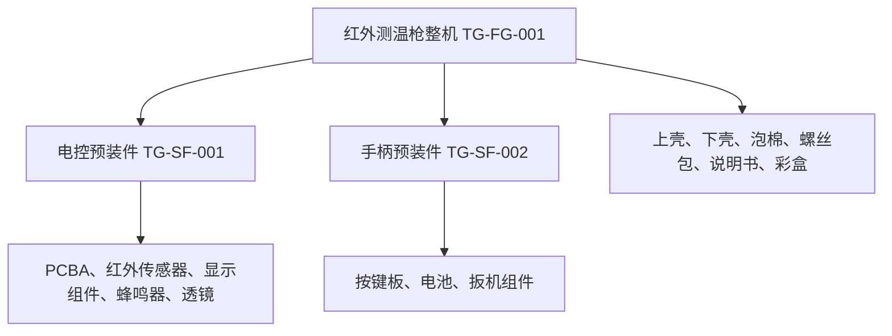
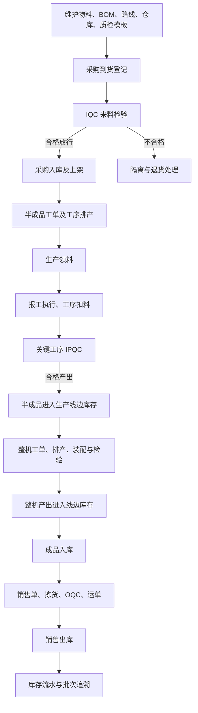

# 红外测温枪 MES：项目审阅与业务流程梳理

审阅日期：2026-10-25。用途：小组理解业务、制定整改顺序、准备答辩和现场核验。

## 1. 结论与审阅边界

项目已具备较完整的 MES 模块骨架，自设产品也有足够复杂度：初始化脚本定义 1 个整机、2 个自制半成品、14 种外购物料，配置了多级 BOM、工艺路线、仓库、检验方案及角色。库存事务集中处理、流水只读查询、智能助手将模型解析与业务取数分离，这些方向值得保留。

当前最值得投入的工作是保证业务数据准确、来源关系一致、操作只能执行一次。继续增加页面或美化界面，收益低于修复这些问题。尤其要优先解决自动 IPQC 来源错配、单据重复过账、智能查询统计错误，以及驾驶舱隐藏实际线边仓的问题。

本次以当前工作区代码为准，交叉阅读了前端页面、后端 Controller/Service/MyBatis Mapper、初始化 SQL、自动化触发器、演示脚本及原有说明。评分文件实际名称为 `答辩评分 (1).pptx`，其中主要要求以图片形式嵌入，本次直接查看了原始评分图片。

验证边界：

- 已执行智能助手实际方法的隔离验证，使用固定输入数据，不连接数据库，确认了三个确定性逻辑问题，详见第 5 节。
- 已运行现有 `scripts/check-vue.mjs`，智能助手、驾驶舱、生产报工、过程检验四个页面的模板和脚本语法检查通过。
- 未启动或登录系统、未连接数据库核对存量数据、未执行会新增业务单据的演示脚本，也未运行完整前后端构建。因此不能据此认定“现场全流程已通过”或给出实际得分。
- SQL 中存在触发器定义不代表当前数据库已安装该触发器；初始化脚本中的数量也不代表运行库当前数量。
- 未修改原有代码、SQL 和 `业务流程说明.md`。本文件是独立审阅版。代码位置中的行号对应审阅时文件，后续修改后请按方法名定位。

## 2. 评分规则决定优化顺序

### 2.1 必须先守住前两档

PPT 第 2 页规定逐档解锁：低档位核心项未全部达成，高档位不评分。不要把 D3、D4 当作可以弥补基础缺陷的独立加分。

1. **D1 基础系统，40 分**：共 8 项，每项 5 分。包括登录运行、主数据 CRUD、仓储 CRUD、生产 CRUD、质量 CRUD、设备和排班、文档对应、自设产品生产链。
2. **D2 全流程闭环，25 分**：采购入库、建工单并领料、生产执行、成品入库、销售发货，各 5 分。重点是每一步库存与工单进度的真实变化。
3. **D3 智能体，20 分**：准确率 12 分、展示 5 分、交互 3 分。现场会随机准备时间、品类、单据维度查询，并包含超纲问题；结果须与业务页面交叉核验。
4. **D4 深度定制，15 分**：真实业务可视化 6 分、流程优化 5 分、自动化编排 4 分。自动化需现场完成至少一条完整链路。
5. **加分最多 5 分**：代码质量与单元测试最多 2 分，小组答辩理解最多 3 分。总分上限 100。

PPT 第 3 页另有产品要求：BOM 原材料至少 6 种，至少 10 种为满项。应展示递归展开后的 14 种外购物料，不能仅展示整机的 8 行直接子项后就结束讲解。

### 2.2 现场证据准备

- D1：准备六大业务模块的 CRUD 样例，并补齐“需求条目—设计—页面—接口—数据表—验收用例”对应关系。现有《改造与验证说明》可以作为起点，不能用本文替代正式系统设计说明书。
- D2：每一步展示单据、库存现有量、库存流水。特别核对 `XBK_VIRTUAL`，因为代码把它作为主要生产线边过账仓。
- D3：用有期初余额、跨月流水、多仓库存和多个同类物料的数据测试，不能只测一条预设问题。
- D4：演示业务操作后图表自动变化，展示自动任务的来源单、检验结果和回写结果。
- PPT 第 7 页规定：演示 15 分钟、问答 5 分钟；超时每分钟扣 1 分。启用录屏备用对应项按八折计分。不能把修改数据库凑出的结果作为业务执行证据。

## 3. 系统到底解决什么问题

业务目标是记录一批测温枪“用了什么料、在哪些工序加工、谁完成、检验是否合格、进入哪个仓库、最后发给哪个客户”，并让单据、库存与生产进度保持一致。

### 3.1 人员分工与模块职责

- **工艺员**：维护物料、单位、BOM、工序、工艺路线、工作站、工序投料关系。回答“生产什么、用什么、怎么做”。
- **计划员**：创建生产工单，安排半成品和整机任务，分配工作站与时间。回答“生产多少、何时交付、由哪里生产”。
- **仓库员**：到货登记、上架入库、领退料、成品入库、销售出库、库存核对。回答“物料现在在哪里、为什么变化”。
- **生产操作员**：按工序任务报工，登记数量与人员。报工保存和报工执行是两个不同动作。
- **质检员**：维护检验标准，完成 IQC/IPQC/OQC，登记合格、不合格数量与缺陷。决定相关物料是否允许放行。
- **设备员**：台账、点检、保养、维修。设备模块有入口，不代表已与排产自动联动。
- **班组长**：班组、班次、人员安排与日历。
- **管理员**：账号、角色、菜单、字典、编码规则和日志。答辩不能全程只使用管理员来证明权限划分有效。

### 3.2 技术与业务分层

Web 页面位于 `ktg-mes-ui/src/views/mes`，API 封装位于 `src/api/mes`。后端业务模块位于 `backend/ktg-mes/ktg-mes`，主要按 `md` 主数据、`wm` 仓储、`pro` 生产、`qc` 质量、`dv` 设备、`cal` 排班划分。

请求路径通常是：Vue 页面 → HTTP API → Controller → Service → MyBatis Mapper → MySQL。

Spring Security/JWT 负责认证与接口权限，Redis用于登录令牌等缓存能力，MinIO用于配置启用时的文件对象存储。库存、工单和质量结果的事实来源应是业务数据库。当前部分关键业务编排位于 Controller，后续宜统一下沉到事务性 Service，使 PC 和移动端复用同一规则。

### 3.3 三种 BOM/工艺概念要分清

- `md_product_bom`：产品组成。整机直接由两个半成品和六类直接物料构成，半成品再展开到外购件。
- `pro_workorder_bom`：创建工单时生成的用料需求。`ProWorkorderController.generateBomLine`按工单数量乘直接 BOM 用量；另有 `getBoms`递归展开叶子材料用于查询。不要讲成“建整机工单自动完成所有半成品生产”。
- `pro_route_product_bom`：工艺路线中每道工序消耗什么料。例如电子件在预装工序消耗，说明书和彩盒在包装工序消耗。它影响报工时的实际扣料。

半成品应先安排生产、完成检验并形成可用产出，再投入整机装配。现有演示脚本也是分别建立电控、手柄和整机工单。

### 3.4 多级产品结构



初始化脚本中每套手柄需要 2 节电池。因此生产 10 台整机、没有损耗且没有期初半成品时，需要 10 套电控预装件、10 套手柄预装件、20 节电池；其他外购叶子物料按当前 BOM 通常为各 10 个对应单位。螺丝包的单位是“包”，不能误按“颗”领料。

证据：`sql/thermometer_init.sql`第 367 行起的 BOM 和第 435 行起的工序投料配置。以上是配置计算示例，不是运行库的实际生产结果。

## 4. 主业务流程：单据怎样驱动库存与进度

### 4.1 全链路概览



这张图表达目标业务顺序。异常隔离、不可越序和放行控制是否完整，仍需按第 5、7 节验证；当前代码存在能绕过部分流程的入口。

### 4.2 到货与来料检验

**参与者**：仓库员、质检员。

1. 登记到货通知，填写供应商、采购关联信息、物料和数量。
2. 标记是否需要 IQC，质检员按适用模板检验。
3. 记录检测数量、合格数、不合格数、检测项目与结论。
4. 对放行物料创建采购入库单，分配仓库、库区、库位和批次，核对上架明细数量，再执行入库。

**关键对象**：`wm_arrival_notice`及行、`qc_iqc`及行、`wm_item_recpt`及行/明细。

**业务区别**：到货通知表示货已到；采购入库执行才形成库存变化。不能以“保存成功”证明已经入库。

**通过证据**：采购入库单已执行；同物料、批次、库位的原料仓结存增加；`wm_transaction`出现对应正向流水。

仓库结构是仓库 `wm_warehouse` → 库区 `wm_storage_location` → 库位 `wm_storage_area`。务必核对名称和 ID 对应关系。

### 4.3 工单与排产

**参与者**：计划员、工艺员。

1. 创建半成品及整机工单，选择产品、计划数量、交期。
2. 系统按产品 BOM 生成工单用料需求。
3. 确认工单，再按工艺路线配置工序任务、工作站和时间。
4. 查看任务与工单、工艺、工作站的关联是否一致。

**关键对象**：`pro_workorder`、`pro_workorder_bom`、`pro_task`、`pro_route`、`pro_route_process`、`md_workstation`。

**通过证据**：工单 10 台，直接物料需求按用量计算；半成品分别有生产安排；任务覆盖实际工艺。

当前初始化路线：电控预装→通电测试；手柄预装→功能测试；整机总装→功能测试→温度校准→出货检验工序→包装。整机路线中的“出货检验”工序与销售单触发的 OQC 是不同业务记录，答辩要区分。

### 4.4 生产领料

**参与者**：仓库员。

创建领料单并关联工单，选择物料、批次与来源库存，核对数量后执行。

`StorageCoreServiceImpl.processIssue`为同一次领料创建两笔库存事务：原料仓减少、目标线边仓增加，并设置关联事务 ID。当前目标仓由 `UserConstants.VIRTUAL_WH`确定，为 `XBK_VIRTUAL`，不是界面名称为“线边库”的另一个仓库。

**关键对象**：`wm_issue_header`、`wm_issue_line`、`wm_issue_detail`、`wm_material_stock`、`wm_transaction`。

**通过证据**：领料 10 个 PCBA 后，原料仓 -10，实际生产线边仓 +10。同一物料跨仓总量不变。此时还没有发生生产消耗。

### 4.5 报工、扣料与产品产出

**参与者**：操作员、质检员。

1. 保存报工单，关联工单、工序任务、工作站，填写生产数量。
2. 调用报工执行接口后，按工序投料配置生成消耗记录，扣减线边物料。
3. 关键工序生成产品产出单。
4. 不需检验时执行产出；需要检验时进入待检分支，待质量检验完成后执行产出并更新工单/任务数量。

**关键对象**：`pro_feedback`、`wm_item_consume`、`wm_product_produce`及行/明细、`qc_ipqc`、`pro_task`、`pro_workorder`。

**当前实现需要准确解释**：

- 保存报工不等于完成扣料、产出与进度回写。
- `ProFeedbackController.execute`只在关键工序分支调用产出及相关进度处理，不是每道工序都给整机成品库存加 10。
- `ProFeedbackServiceImpl.updateProTaskAndWorkorderByFeedback`按报工总数增加已生产数量，其中包含不良品。已生产数不能直接等同可销售合格数。
- `QcIpqcController.edit`处理 `FEEDBACK`来源时，约定 `sourceDocId`指向产品产出单，`sourceLineId`指向产出行，`sourceDocCode`记录报工编码。该约定与自动化触发器目前不一致，必须先修复。

**通过证据**：消耗单、产出单、质检单能互相定位；扣料只发生一次；只有规定的产出节点增加产品库存；不合格数量单独可查。

### 4.6 成品入库

**参与者**：仓库员。

从已形成的整机线边库存建立产品入库单，指定成品仓及批次、库位，执行后：线边整机 -10，成品仓整机 +10。

**关键对象**：`wm_product_recpt`及行/明细、`wm_material_stock`、`wm_transaction`。

成品入库属于位置转移，不应把工单已生产数再次加 10。当前执行实现允许线边库存暂时为负，不能仅凭成品仓有数量就断言前序生产已完成。

### 4.7 销售发货

**参与者**：仓库员、质检员；客户作为销售单的业务关联对象。

销售出库单关联客户，填写产品数量，安排拣货明细、出货检验和运单信息，放行后执行销售出库，成品仓库存减少。

**关键对象**：`wm_product_sales`及行/明细、`qc_oqc`、`md_client`、`wm_transaction`。

销售发货是系统边界内的库存减少，不需要给“客户仓库”增加库存。当前后端执行接口没有完整校验销售单状态和 OQC 放行，见问题 R03。

### 4.8 库存核对方法

先固定物料、批次、仓库/库位、时间和计量单位，再核对：

```text
期末库存 = 期初库存 + 本期正向流水合计 - 本期负向流水绝对值合计
仓间转移：来源仓减少量 = 目标仓增加量
成品可发数量：以合格、可用库存为依据，不能用工单已生产数替代
```

用 PCBA 举例：初始 0，采购入库 10，领料后原料仓 0、线边 10，预装工序消耗后线边 0。用整机举例：关键产出 10，成品入库后线边 0、成品仓 10，销售 10 后成品仓 0。这些是无损耗、无其他单据的预期增量；存在历史库存时要比较操作前后差额。

批次追溯需要“物料+批次+来源单据/行”等关联共同定位。批次编码本身不应被表述为全系统唯一数据库主键。

### 4.9 支撑业务与扩展功能

- **设备和排班**：维护设备、点检保养、维修、班组和日历。进一步可将设备停机、班组可用时间纳入排产校验，当前不能宣称已自动完成此约束。
- **智能助手**：前端规则识别常用问题，未命中时调用后端模型解析；随后查询业务接口并在前端统计。模型本身没有执行 SQL，方向合理，但统计与筛选规则必须修正。
- **驾驶舱**：四类图表与 KPI，每 30 秒刷新业务接口。目前查询上限、仓库筛选和指标口径存在问题。
- **自动化触发器**：报工插入自动创建 IPQC、采购入库完成自动创建 IQC 复检。它们属于数据库层逻辑，部署和验收必须包含 SQL。
- **小程序**：当前是产品目录、询价和个人信息展示原型；不能作为已经打通 MES 库存/报工的移动端证据。

## 5. 优化问题清单：证据、影响与验收

优先级定义：P0 为会阻断主要业务或严重损害账实一致性，P1 为影响评分准确性/可靠性的缺陷，P2 为工程质量与扩展性改进。“代码确认”不表示已经对当前运行数据库复现。

### R01｜P0｜自动 IPQC 与检验完成接口的来源 ID 语义冲突

**证据**：`sql/auto_ipqc_trigger.sql:13`在报工插入后触发；第 57 行把 `NEW.record_id`即报工 ID 写为 `source_doc_id`，未写入产出行 ID。`QcIpqcController.java:252`说明来源约定，`:257`实际按这个 ID 查询 `wm_product_produce`，随后读取 `sourceLineId`对应的产出行。

**影响**：自动单可出现在待检列表，但完成检验时可能找不到产出单/产出行而报错；不同表 ID 偶然相同还可能误关联。保存草稿时可能尚未生成产出单，因此仅增加检验明细不能解决来源问题。

**建议**：把自动任务生成放到报工执行、产出单及产出行创建完成之后，使用明确的来源类型和来源 ID；使用同一 Service 实现手动和自动生成。按产品、检验类型、启用状态匹配模板，避免触发器简单取第一套 IPQC 模板。

**验收**：新建两笔报工，分别自动生成正确来源的检验单；一笔全合格、一笔含不良，均能完成检验、正确产出和回写，且互不影响。重复提交不重复生成。状态：代码交叉确认，待数据库联机复现。

### R02｜P0｜入库、出库、检验完成缺少业务幂等保护

**证据**：`WmProductRecptController.execute`（约第 179 行）和 `WmProductSalesController.execute`（约第 196 行）查询后直接过账，没有校验旧状态必须是待执行，也没有原子状态抢占。对应 Mapper 的过账查询仅按单据 ID 取明细。`QcIpqcController.edit`只要传入 `FINISHED`便进入产出和进度累加分支。

**影响**：刷新重试、重复接口调用可重复增加成品库存或重复扣减销售库存；检验重复完成可重复累加产量。`@Transactional`保证一次调用的提交/回滚，不会阻止第二次调用。前端 1 秒重复请求拦截也不等于后端幂等。

**建议**：统一事务 Service；以旧状态条件更新或行锁控制一次性执行；过账记录建立合适的业务唯一键，包含来源单据/明细、事务类型、方向等维度，兼容一行分多个批次。已经执行的请求返回已执行结果或明确拒绝。

**验收**：顺序调用两次、并发调用两次、超时重试，均只产生一次库存变化和一次产量增量。状态：代码确认，未对真实库执行重复请求。

### R03｜P0｜销售出库可绕过质量和状态门禁

**证据**：`WmProductSalesController.execute`只校验存在单据行，未验证旧状态、OQC 结果、拣货数量一致性；`WmProductSalesMapper.xml:getTxBeans`也没有限定质量与放行状态。

**影响**：有执行权限的调用者可绕过页面流程，直接执行待检甚至草稿销售单；库存足够不代表产品已经合格放行。

**建议**：在执行服务中校验允许状态、行/明细数量、有效客户、批次、质量结果、冻结与可用库存。PC 和 mobile 使用同一服务规则。

**验收**：待检、拒收、未完成拣货、数量不一致的销售单均不得过账；放行且数量正确才成功。状态：代码确认。

### R04｜P1｜智能库存期初固定为 0，期末实际上只是净变动

**证据**：`ktg-mes-ui/src/views/mes/ai/index.vue:262`固定 `begin: 0`，`end`只计算期间入库减出库。批次结存也采用同样逻辑。

**隔离验证**：调用原组件的 `queryStock`，期间 +10、-3 时返回期初 0、期末 7；若真实期初为 100，正确期末应为 107。该方法没有查询期初，无法区分这两种情况。

**建议**：后端按指定范围计算期初余额、期间流入/流出及期末余额；明确初始化余额来源。按物料、单位、仓库、批次分组，保持与库存查询一致。

**验收**：期初非零、当月无流水、跨月有流水、库存转仓四类样例都能对账。直接影响 D3 的时间查询准确率。

### R05｜P1｜智能查询时间参数未进入后端日期条件

**证据**：AI 页面第 272 行等位置传顶层 `beginTime/endTime`；`WmTransactionMapper.xml:83`、`:84`读取的是 `params.beginTime/params.endTime`。请求拦截器只序列化参数，没有把这两个顶层字段移动到嵌套 `params`；`WmTransaction`也没有对应顶层时间字段。

**影响**：用户问“10 月”，实际可能得到全部月份流水。即使修复参数绑定，`<= '2026-10-31'`也可能漏掉 31 日零点以后的流水。

**建议**：统一查询 DTO 与参数协议；日期采用起点包含、下一日/下一月起点不包含的范围。显式年份不能被忽略，非法月份应追问或拒绝，时区统一为业务时区。

**验收**：9 月末、10 月初、10 月 31 日 23:59、11 月初的四条记录，只返回两条 10 月记录。状态：请求对象隔离验证与 Mapper 静态交叉确认，未进行 HTTP 绑定联测。

### R06｜P1｜智能助手品类、业务类型和多轮语义未落到查询

**证据**：`index.vue:162`先匹配“库存”，后匹配“安全库存”；`matchItem`对多个品类匹配只返回第一个；`queryFlow`仅按数量正负分类；`route`只使用模型的 metric，没有将 timeText/category/warehouse 形成查询条件；`queryWorkorder`不接收问题里的单据和时间条件。

**隔离验证**：

- “现在哪些物料低于安全库存”实际命中 `queryStock`，不会进入预警查询。
- 给 `queryFlow`输入采购入库 +5 和内部领料入库 +8，采购问题返回 13，混入了内部移动。

**建议**：预警规则优先；建立统一查询对象，包括指标、时间范围、物料集合、仓库、业务单据类型及编号；所有槽位都经过校验后参与后端过滤。模糊命中多个物料应展示范围或追问。保存已确认的上下文，使“那上个月呢”能够继承物料与仓库。

**验收**：电子件全品类汇总、指定采购单号、指定仓库、追问上月、未知物料及超纲问题均有明确结果，不能默认退化为全库统计后仍声称回答准确。

### R07｜P1｜统计只取前 500 行，质检口径混入未完成数据

**证据**：AI 页面 `get`及驾驶舱 `get`固定请求第 1 页、500 行，没有遍历后续页；`queryInspection`按 `createTime`筛选，没有限制已完成检验，并把未填写不良数当作 0。

**影响**：第 501 条以后被静默遗漏；待检 10 件、不良数空值可能被算为 100% 合格。使用创建时间也不等同检验完成时间。智能体“检验”查询当前只统计 IPQC，并不涵盖 IQC/OQC。

**建议**：后端聚合完整结果，明细另行分页；只统计有效完成检验，按检验时间计算，明确分母为检验件数还是检验批次；无有效检验显示“暂无可统计结果”。

**验收**：501 条数据统计无遗漏，增加待检单不改变已完成检验合格率，IQC/IPQC/OQC 范围明确。

### R08｜P1｜驾驶舱线边库存与实际业务仓不一致

**证据**：`StorageCoreServiceImpl:104`起的领料逻辑将物料转入 `XBK_VIRTUAL`；驾驶舱 `index.vue:318`起只汇总名称为“原料仓、线边库、成品仓”的仓库，并排除虚拟过账仓。

**影响**：业务领料已成功，图上的线边库存却可能不增加，D2 与 D4 的现场对账会出现矛盾。

**建议**：统一生产仓定义，按仓库 ID/类型查询，明确业务线边仓和纯技术过账仓。若保留虚拟仓，展示它与实际生产库存的对应关系和未结转量，不能只隐藏负数。

**验收**：同一笔领料在单据、库存现有量、库存流水和驾驶舱上显示一致增减。

另外，驾驶舱把不同单位的库存直接相加，容易把“台、套、节、包”混成一个没有业务意义的总量；按物料/单位展示数量，或改为 SKU 数、缺料品种数等指标。`WORKING`设备数占比应叫“运行状态占比”，不能直接代表按时间计算的设备稼动率。

### R09｜P1｜自动化与展示数据有验收边界

**证据一**：`scripts/demo-history.sql`直接插入工单、报工、库存，并更新设备状态，主要用于丰富图表；它不通过正常业务执行链生成全部流水。

**建议**：明确这是界面样例数据。正式闭环演示使用隔离数据库，通过页面或业务 API 产生单据、流水与结存。避免把“HIST”样例当成真实生产历史，也不要在已有业务库盲目重跑清理脚本。

**证据二**：`ktg-mes-mp/utils/api.js:12`只要传入 mock 就直接返回；目录、询价提交、列表、个人信息均传入 mock。询价提交返回随机编码，但没有持久化链路证据。

**建议**：答辩明确标注为原型，或接入后端并以重新进入列表仍可查询证明持久化。D2 允许 PC 报工，没必要为了展示移动端而引入不可验证链路。

**证据三**：`sql/auto_iqc_trigger.sql`为入库完成后复检，区别于原有入库前 IQC；按第一套启用 IQC 模板建单，没有建立明确的复检失败库存冻结闭环。

**建议**：说明业务目的、复检覆盖范围及失败处理，按物料匹配模板。生成任务不等于自动化闭环已完成。

### R10｜P1｜库存约束和并发控制需要下沉到数据库事务

**证据**：`WmTransactionServiceImpl:57`使用 Java `synchronized`，以“读余额—计算—覆盖写余额”处理库存；`WmMaterialStockMapper.xml`写入绝对余额，未见版本条件或行锁。库存不存在的分支（约第 84 行）直接写入有符号数量，未应用库存不足判断。`StorageCoreServiceImpl:273`及产品入库分支显式允许负线边库存。

**影响**：同一 JVM 内同步不能替代跨实例数据库锁；外层事务尚未提交时也不能仅靠方法锁保证所有事务可见性。库存不存在的出库路径可能绕过负库存限制。虚拟仓允许负数可用于特定补录业务，但会掩盖漏领料、漏报工。

**建议**：库存原子增减、版本号/行锁、业务维度唯一约束；出库数量必须正数；不存在库存也要执行余额校验；库存更新、流水插入、单据状态更新使用统一事务。负库存策略按仓库和业务类型显式配置，留下异常审批/补录记录。

**验收**：库存 10，两笔并发出库各 7，只允许一笔成功，最终余额 3；中途异常不得留下半笔转移。状态：代码风险确认，未进行并发压测。

### R11｜P2｜状态、事务与接口权限规则分散

**证据**：PC 和 mobile 分别包含销售出库业务编排；`ProFeedbackController.list`没有与导出/详情一致的 `@PreAuthorize`；`MesAiController.intent`没有单独的功能权限和额度限制，虽然仍受全局登录认证限制。

`QcIpqcController.remove`在循环中先删除前一张单的明细，如果后一张不是草稿，直接返回错误，`@Transactional`不会因为普通错误返回值自动回滚，存在部分删除风险。相似模式值得全库排查。

**建议**：Controller只处理输入输出和权限，Service负责状态与事务；批量操作先全量校验再写入，或抛出可回滚业务异常。新增专用 DTO，服务端从工单和任务派生产品、工序等可信字段。AI 接口增加角色权限、输入长度、频率和调用额度控制。

**验收**：使用仓库员、操作员、质检员分别验证允许与拒绝的操作；批量删除“草稿+已完成”时所有单据均保持原状。

### R12｜P2｜部署、测试和密钥配置缺少统一交付约定

**证据**：`MesAiController.readKey`含绝对路径 `E:/JavaCode/ai-keys.txt`兜底，`status`只看注入配置，可能与实际可用密钥来源不一致；当前 `.gitignore`已忽略 ai-key 文件，本次没有读取或输出密钥，也未发现该文件被 Git 跟踪。

**建议**：统一环境变量/本地配置加载，提供不含密钥的配置样例；状态检查复用相同配置解析。模型原始异常留在服务端，客户端显示错误编号。记录调用次数、耗时与用量作为成本说明，不能把源码注释里的“免费”当作当前计费依据。

后端未检索到 `src/test`测试目录。现有演示脚本有流程检查，但末尾库存核对主要为打印结果，不是完整的库存断言；`demo-flow.mjs`还把整机包装等工序放在温度校准检验之前执行，应对齐工艺顺序并补前置任务门禁。

**建议**：优先增加针对库存守恒、重复执行、检验来源、权限拒绝和时间范围的回归测试；数据库变更按编号迁移，明确触发器安装、升级、回滚与检查步骤。初始化脚本带清空业务表操作，不能当作普通增量升级脚本。

当前版本配置为 Spring Boot 2.5.12、Vue 2.6.12 等。版本升级应列为后续工程工作，先评估兼容性、维护状态和依赖风险，再规划升级；本次未进行外部漏洞数据库核查，不据版本号宣称存在特定漏洞。

## 6. 推荐整改顺序与分工

### 第一轮：保证可以可靠演示 D1/D2

1. 后端/质量负责人：修复 R01 来源关系，打通“报工执行—自动检验—检验完成—产出—进度回写”。
2. 后端/仓储负责人：修复 R02、R03，统一执行状态、幂等、质量门禁及数量校验。
3. 前端/仓储负责人：修复 R08，统一线边仓口径，支持由图表跳转到对应库存/流水明细。
4. 测试/文档负责人：通过业务接口生成一套可追溯数据，记录每一步增量；验证六模块 CRUD 和岗位权限。

完成标准：同一套单据可以从原料到销售现场走通，重复点击不改账，待检不出库，库存与流水一致。

### 第二轮：让 D3 经得住随机提问

1. 将库存与检验统计集中在后端，先解决 R04、R05、R07。
2. 修复 R06，完整应用模型槽位与规则条件。
3. 加入答案数据范围、计算口径、业务链接、无结果提示与追问。
4. 覆盖时间、品类、单据三类问题，各自准备人工查询对照，但不要只对预设问法硬编码。

完成标准：随机改变月份、物料和仓库仍准确；明细超过 500 行也不漏算；超纲问题明确说明不能回答。

### 第三轮：展示有意义的 D4 与工程质量

1. 完整演示一条可靠自动化链路，不只展示待检数量增加。
2. 四张图统一使用可靠聚合接口，明确单位与时间口径。
3. 整理配置、数据库迁移和业务回归测试。
4. 小程序是否接入真实后端根据时间决定；未完成时诚实标注原型，不影响 PC 主链演示。

## 7. 必须跑过的验收用例

以下是建议验收清单，不是本次已经执行通过的用例。使用隔离验收库，先记录期初。

- [ ] T01 登录：各岗位登录、菜单加载、退出、越权接口拒绝。
- [ ] T02 基础 CRUD：六大模块分别完成新增、查询、修改、合法删除；被引用主数据不能任意删。
- [ ] T03 BOM：10 台整机递归展开 14 类外购物料，电池需求 20 节，半成品依赖清楚。
- [ ] T04 入库：采购入库后指定物料/批次/库位增加正确数量，重复执行不增加。
- [ ] T05 领料：原料仓减少与实际线边仓增加一致；库存不足时整单回滚。
- [ ] T06 报工：工序投料正确，关键产出一次，非关键工序不重复增加整机产量。
- [ ] T07 质检：自动 IPQC 来源正确，明细齐全，全合格/部分不合格均可完成并正确回写。
- [ ] T08 质量门禁：待检、拒收不得直接销售；合法放行后才允许出库。
- [ ] T09 库存闭环：成品入库和销售都能按单据追溯，结存与流水守恒。
- [ ] T10 幂等：入库、出库、检验完成各重复请求两次，不重复记账或累加进度。
- [ ] T11 并发：库存 10，两个会话各出 7，只成功一笔且余额为 3。
- [ ] T12 时间：跨月、月末最后一秒、显式年份、有期初余额均统计正确。
- [ ] T13 智能筛选：品类汇总、指定仓库、指定单号、多轮追问、超纲问题全部核对。
- [ ] T14 统计：超过 500 条仍完整；待检记录不计为合格；不同单位不直接相加。
- [ ] T15 驾驶舱：业务执行后 30 秒内更新，数量和业务页面一致。
- [ ] T16 批量删除：草稿与已完成单混选，拒绝后原有头和明细均不变。
- [ ] T17 全新部署：从干净库按交付步骤运行，触发器、菜单、权限、主数据齐备。

## 8. 15 分钟答辩演示建议

1. **0:00—1:00：业务与架构。**说明测温枪、两类半成品、14 种原料、角色和系统边界。
2. **1:00—4:00：D1。**登录并展示六模块，重点做一组 CRUD，展示多级 BOM、工艺路线以及需求/设计映射。
3. **4:00—9:00：D2。**按采购入库、领料、报工/检验、成品入库、销售顺序完成关键操作。每步切库存和流水，指出增减与来源单号。部分草稿可提前通过正常业务建立，以节约录入时间。
4. **9:00—12:00：D3。**回答现场指定的时间、品类、单据问题，切业务页面核对，并演示超纲问题处理。
5. **12:00—14:30：D4。**展示四张图和自动刷新；执行一次自动生成检验任务并回写业务的完整链路；说明减少了什么重复操作。
6. **14:30—15:00：工程证据。**展示关键回归测试和小组分工，留出问答。

正式答辩前用秒表预演。预置主数据和业务草稿可以提高效率，但不要通过修改库存余额或生产完成数伪造执行结果。

## 9. 小组每个人都应能回答的问题

**为什么领料后库存总量不变，报工后原料总量下降？**

领料是原料仓转移到线边仓；报工执行按工序用料进行生产消耗，物料转化为半成品或整机，二者是不同业务事务。

**为什么生产报工和成品入库分开？**

报工记录生产及质量结果，产出先形成线边库存；成品入库完成仓储交接和位置转移。合格产出、仓储位置和工单进度不能混为一个字段。

**为什么有事务还需要幂等？**

事务保证一次操作的多个写入一致；幂等保证同一业务动作被请求多次时，不会被记账多次。

**为什么不能只让大模型回答库存？**

数量必须由可核对的数据库查询和确定性计算给出。模型用于理解问题，答案应携带时间、物料、仓库、来源单据和统计口径。

**为什么使用 Redis 和 MinIO？**

Redis承接登录令牌、验证码等缓存场景；MinIO承接文件对象存储。它们各自解决不同问题，不替代关系数据库记录业务单据与库存。

**项目改造点如何与开源框架区分？**

据实说明若依与 KTG MES 提供的基础能力，再展示测温枪产品建模、多级 BOM、业务闭环验证、库存流水查询、智能助手、驾驶舱和自动化等具体改造及代码证据。团队需要能解释每个改造的输入、规则、输出与异常处理。

## 10. 代码导航与证据索引

以下路径相对项目根目录 `E:/JavaCode`，可按类名/方法名搜索：

- 评分依据：`答辩评分 (1).pptx`，第 2—7 页。
- 产品/BOM/工艺/角色配置：`sql/thermometer_init.sql`。
- 创建工单与 BOM：`backend/ktg-mes/ktg-mes/src/main/java/com/ktg/mes/pro/controller/ProWorkorderController.java`。
- 报工执行：`backend/ktg-mes/ktg-mes/src/main/java/com/ktg/mes/pro/controller/ProFeedbackController.java`。
- 生产进度回写：`backend/ktg-mes/ktg-mes/src/main/java/com/ktg/mes/pro/service/impl/ProFeedbackServiceImpl.java`。
- 质检完成与产出：`backend/ktg-mes/ktg-mes/src/main/java/com/ktg/mes/qc/controller/QcIpqcController.java`。
- 库存动作编排：`backend/ktg-mes/ktg-mes/src/main/java/com/ktg/mes/wm/service/impl/StorageCoreServiceImpl.java`。
- 库存余额与流水：`backend/ktg-mes/ktg-mes/src/main/java/com/ktg/mes/wm/service/impl/WmTransactionServiceImpl.java`。
- 成品入库：`backend/ktg-mes/ktg-mes/src/main/java/com/ktg/mes/wm/controller/WmProductRecptController.java`。
- 销售出库：`backend/ktg-mes/ktg-mes/src/main/java/com/ktg/mes/wm/controller/WmProductSalesController.java`。
- 库存 SQL：`backend/ktg-mes/ktg-mes/src/main/resources/mapper/wm/WmTransactionMapper.xml`、`WmMaterialStockMapper.xml`。
- AI 页面：`ktg-mes-ui/src/views/mes/ai/index.vue`。
- AI 模型代理：`backend/ktg-mes/ktg-mes/src/main/java/com/ktg/mes/ai/controller/MesAiController.java`。
- 驾驶舱：`ktg-mes-ui/src/views/mes/dashboard/index.vue`。
- 自动化：`sql/auto_ipqc_trigger.sql`、`sql/auto_iqc_trigger.sql`。
- 演示及样例数据：`scripts/demo-flow.mjs`、`scripts/demo-history.sql`。
- 小程序模拟接口：`ktg-mes-mp/utils/api.js`。

本文件的完成不代表上述缺陷已经修复。建议把 R01—R12 转成小组任务，以第 7 节验收结果作为完成依据。
